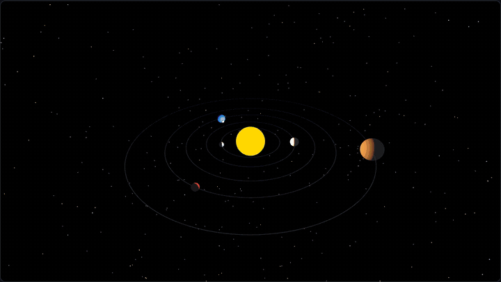
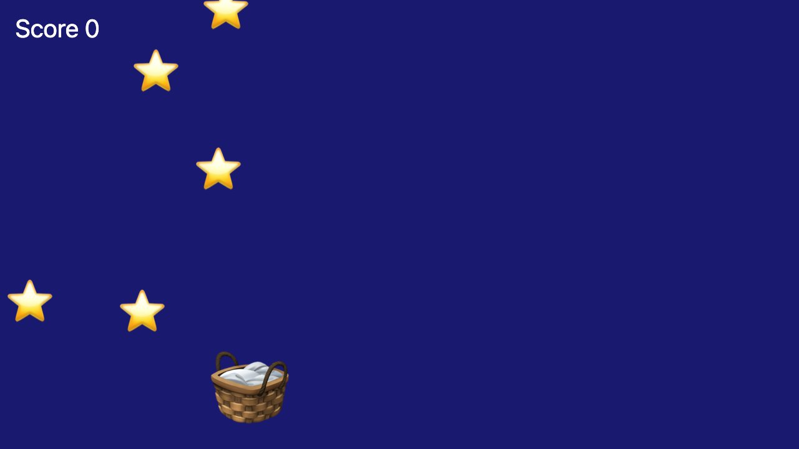
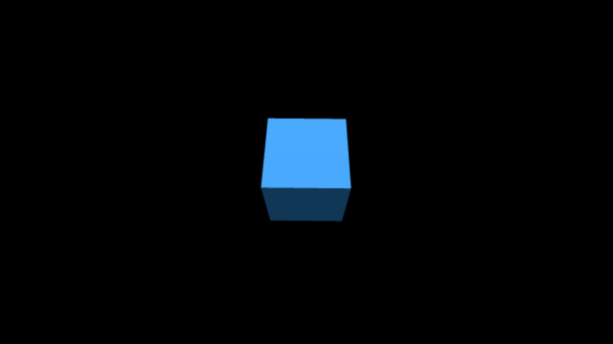
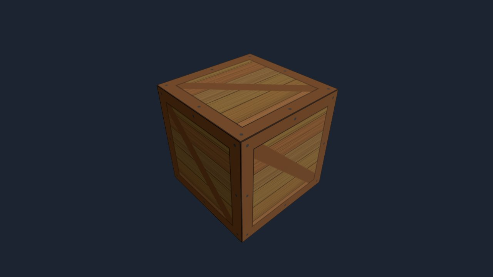
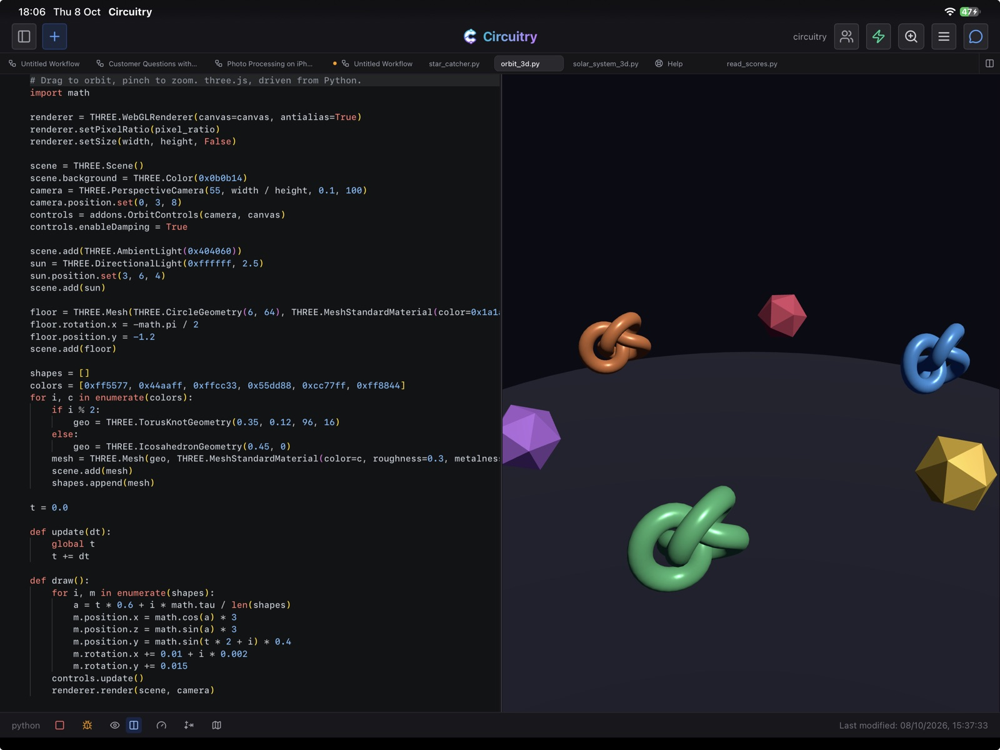

# Pyctures

[](https://pypi.org/project/pyctures/) [](https://www.npmjs.com/package/pyctures) [](https://pypi.org/project/pyctures/) [](LICENSE)

[](https://johnwylie70.github.io/pyctures/)

**[See them running in your browser, with their code →](https://johnwylie70.github.io/pyctures/)** Nothing to install. Or **[change the code and run it on the Pyctures page →](https://www.circuitry.dev/pyctures)**

Pyctures ("Python pictures") is for making 2D and 3D graphics and games in Python, and for enjoying it. It is for any age and any level, a first program or a thousandth: you type a few lines and see something move. It is designed to bring the joy back into programming. Write a short Python program and it draws in your web browser: shapes, text, moving sprites, games, animations, live charts and lit 3D scenes. Underneath are the web's 2D canvas and three.js, with the names JavaScript uses, so any JavaScript graphics example can be brought across easily. Run a scene with your own Python while you write it, then build it into a folder that runs in any browser, on any website.

Prefer JavaScript? [pictures.js](https://www.circuitry.dev/pictures) is the sibling library: the same shape of program (`setup()`, `update(dt)`, `draw()`, `keys`, `mouse`, `Sprite`, three.js) in a plain `.js` file, with no HTML to write. A scene comes across from one to the other with little more than its syntax changed.

## Install

```bash
pip install pyctures
```

Python 3.9 or newer. Nothing else is installed.

## Start with four small scenes

Each one is a whole program, a few lines longer than the last. Nothing of Pyctures needs importing. [How to run one](#run-it) is just below.

**1. Draw something.** Save this as `hello.py`:

```python
def draw():
    background("midnightblue")
    circle(width / 2, height / 2, 80, "gold")
```


`draw()` is called every frame. `background` paints the whole picture, and `circle(x, y, radius, colour)` draws a circle. `width` and `height` are the size of the picture, so this circle sits in the middle.

**2. Make it move.**

```python
x = 0

def update(dt):
    global x
    x += 200 * dt            # 200 points every second
    if x > width:            # off the right edge: start again on the left
        x = 0

def draw():
    background("midnightblue")
    circle(x, height / 2, 40, "gold")
```

`update(dt)` is called before every `draw()`. `dt` is the time since the last frame, in seconds: about a sixtieth of a second on most screens, and less on a faster one. It is there because screens do not all draw at the same rate, and a busy device can drop frames. A program that moved the circle a fixed amount every frame would run faster on one screen than on another. Multiplying by `dt` evens that out: `200 * dt` is 200 points a second everywhere, however many frames that second has. `global x` lets the function change the `x` made outside it. Change the 200 and run it again.

**3. Make it answer you.**

```python
x, y = 200, 150

def update(dt):
    global x, y
    if "ArrowLeft" in keys: x -= 300 * dt
    if "ArrowRight" in keys: x += 300 * dt
    if mouse.down:           # a mouse button, or a finger
        x, y = mouse.x, mouse.y

def draw():
    background("midnightblue")
    circle(x, y, 40, "gold")
```

`"ArrowLeft" in keys` is true while that key is held, and `mouse` is the pointer, or a finger on a touch screen. Click the scene first, so it has the keyboard.

**4. A bit more: a small game.**

```python
basket = Sprite("🧺", 200, 250, size=64)
stars = [Sprite("⭐", random(400), random(300), size=36) for i in range(5)]
score = 0

def update(dt):
    global score
    if mouse.inside:                 # the pointer is over the picture
        basket.x = mouse.x
    basket.y = height - 50
    for star in stars:
        star.y += 200 * dt
        caught = star.touches(basket)
        if caught:
            score += 1
        if caught or star.y > height:    # caught or missed: back to the top
            star.x = random(width)
            star.y = 0

def draw():
    background("midnightblue")
    for star in stars:
        star.draw()
    basket.draw()
    text(f"Score {score}", 12, 30, "white", 20)
```



A `Sprite` is a picture that moves, here an emoji, and `touches` says when two of them meet. Move the mouse, or drag a finger, to catch the stars.

These four are in the examples folder as `hello.py`, `moving.py`, `follow.py` and `first_game.py`. The tutorials carry on from here: [your first drawing](docs/tutorials/first-drawing.md), [a bouncing ball](docs/tutorials/bouncing-ball.md), [a simple game](docs/tutorials/game.md) and [Space Rocks](docs/tutorials/space-rocks.md). The plain functions (`background`, `circle`, `rect`, `line`, `text`) cover a first picture; for everything else there is `ctx`, the web's own 2D drawing surface ([Drawing in 2D](docs/drawing-2d.md)). `save("best", score)` keeps a value and `load("best", 0)` gives it back the next time the scene runs ([Saved values](docs/saved-values.md)). A scene can also write files and keep a SQLite database: `save_text("notes.txt", words)`, `load_json("level.json", {})`, and `db = open_database("scores")` with `db.query(...)` and `db.run(...)` ([Files and databases](docs/files-and-databases.md)).

## Run it

```bash
pyctures run hello.py
```

Your browser opens on the scene. The program runs in your own Python, so numpy and anything else you have installed works. Save the file and the scene runs again. Errors are shown on the page with the line they happened on.

Options: `--port 9000`, `--no-browser`.

## Share it

```bash
pyctures build hello.py -o site/
```

`site/` is a folder of plain files that runs the scene entirely in the browser, with [Pyodide](https://pyodide.org) loaded from its official CDN. Put it on any static host. Every path in it is relative.

Or make one file:

```bash
pyctures build hello.py -o hello.html
```

`hello.html` holds the scene and everything it needs (three.js too, if the scene is 3D), so you can email it, put it on any website, or open it straight from your disk. Python still loads from Pyodide's CDN.

Either way, images the scene loads by a relative path, such as `load_image("textures/brick.png")` or `THREE.TextureLoader().load("textures/brick.png")`, are included automatically: copied into the folder, or packed into the one file. A named image that is missing is reported as a warning.

Python runs in a background thread of the browser (a Web Worker), and the page only draws. A slow frame or a stuck loop cannot hold up the page, so scenes play smoothly on phones and tablets too. Add `?measure=1` to the address to see the frame rate and where each frame's time goes.

## Use it on your website

Either put a built scene in an iframe:

```html
<iframe src="hello/index.html" style="width: 100%; aspect-ratio: 16 / 9; border: 0"></iframe>
```

or put scenes straight into your page, as many as you like:

```html
<div data-pyctures-src="balls.py"></div>
<div data-pyctures-src="knot.py" style="height: 420px"></div>
<script type="module" src="pyctures/pyctures.js"></script>
```

Each canvas fills its box, starts when it scrolls into view, and pauses when it is out of view or the tab is hidden. All the scenes on a page share one copy of Python, in a background thread. `pyctures build my-page/ -o site/` copies your page and adds the `pyctures/` folder. See [Use it on your website](docs/website.md), and the two-scene page in [`examples/website`](examples/website).

## Sound, and dials to turn

A scene can make sound, with one line at the top:

```python
from synths import *

def on_mouse_down(x, y):
    play_sound("coin")
    play_notes("C4 E4 G4 C5", 0.12, after=0.3)

def draw():
    background("midnightblue")
    text("Click for a sound", width / 2, height / 2, "white", 28, "centre")
```

There are ready-made game sounds, notes and tunes, and synths you shape yourself: [Sound and music](docs/sound.md). A MIDI keyboard plays a synth with `lead.play_from_midi()`, and `def on_midi_note(note, velocity, channel):` is called for every key: [MIDI](docs/sound.md#midi). `mic = use_microphone()` is your own voice, as a robot or a monster with `mic.voice = "robot"`, recorded with `take = record_sound(3)` and saved with `save_sound(take, "hello.wav")`: [Your voice](docs/sound.md#your-voice). Sound is new, and not yet in the Pyctures that `pip install pyctures` gives (0.2.0): it will be in the next release. With one more line a scene has dials, sliders and a piano keyboard on it, to play a synth and change it as it sounds: [Dials and a keyboard](docs/dials.md).

```python
from pyctures import *
from synths import *
from pydials import *

lead = make_synth("lead")
dial("cutoff", lead, "cutoff")
dial("resonance", lead, "resonance")
slider("attack", lead, "attack")
scope(lead)
keyboard(lead, octave=4)
```

Both libraries come with Pyctures, and a page loads them only for a scene that uses them.


## Sheet music

A scene can write music out as notes on a staff, play it, and light each note as it sounds:

```python
from pyctures import *
from pynotation import *

page = show_notes("E4 D4 C4 D4 E4 E4 E4:2", "quarter")

def on_mouse_down(x, y):
    page.play()

def draw():
    background("midnightblue")
    text("Click here to play", width / 2, height - 30, "white", 18, "centre")
```

Change the notes in the line and both what you hear and what you see change. A tracker song can be written out a staff a channel and followed as it plays, a sheet can be written a note at a time (`make_sheet()`), and a learner can play along on a keyboard (`page.play_along("wait")`, `keyboard(page)`): [Sheet music](docs/sheet-music.md).
## Effects

A scene can have effects on it, done by the page's graphics card:

```python
from pyvisualfx import *

glow(1)                 # bright things shine
trails(1.5)             # and leave a trail that takes a second and a half to fade

def draw():
    background("black")
    circle(mouse.x, mouse.y, 40, "gold")
```

There are ninety-four: a kaleidoscope, blurs, an old television, glitches, rain and snow, backdrops such as `plasma()` and `fire()` that need no drawing at all, and `look("arcade")` for several at once. Their settings are attributes (`tail.zoom = 2`), and `react(shine, "strength", "bass")` makes one move to the scene's music. The library comes with Pyctures, and a page loads it only for a scene that imports it. See [Effects](docs/effects.md) and [every effect](docs/effects-reference.md), with a picture of each.

[](docs/effects-reference.md)

## Scenes

A file can be several scenes: a title screen, the game and a game-over screen, or the parts of a show on a timer. Each is a class with the same functions a file has, and starts empty.

```python
class Title(Scene):
    def draw(self):
        background("midnightblue")
        text("Click to start", width / 2, height / 2, "white", 30, "centre")

    def on_mouse_down(self, x, y):
        go("Game", transition="crossfade")


class Game(Scene):
    length = 20                 # seconds, then the next scene written begins

    def draw(self):
        background("black")
        circle(mouse.x, mouse.y, 20, "gold")
```

`go`, `next_scene()` and `restart()` change scene, `length`, `beats` or `bars` end one by itself, and `transition = "crossfade"` (or `"fade"`, `"wipe"`, `"slide_left"`…) is how one arrives. The page runs the transition, so it is smooth however busy Python is. A program whose scenes all have a length has a scrubber with a tick where each starts. The words are [Pymations'](https://github.com/johnwylie70/pymations) wherever the thing is the same. See [Scenes](docs/scenes.md).

## Bringing a JavaScript example across

The calls are the same; a few things are written the Python way.

| JavaScript | Python |
|---|---|
| `new THREE.Mesh(g, m)` | `THREE.Mesh(g, m)` |
| `{ color: 0x44aaff, roughness: 0.4 }` | `color=0x44aaff, roughness=0.4` |
| `const x = 1;` `let y = 2;` | `x = 1` `y = 2` |
| `ctx.fillStyle = "red"` | the same, or `ctx.fill_style = "red"` |
| a `requestAnimationFrame` loop | `def draw():` and `def update(dt):` |
| `canvas.addEventListener("click", (e) => …)` | `canvas.add_event_listener("click", clicked)` with `def clicked(e):` |
| `const w = ctx.measureText("Hi").width` | `w = await ctx.measure_text("Hi").width` |
| `Math.PI` | `math.pi` |

```js
// JavaScript
const cube = new THREE.Mesh(new THREE.BoxGeometry(1, 1, 1),
                            new THREE.MeshStandardMaterial({ color: 0x44aaff }));
scene.add(cube);
function animate() {
  cube.rotation.y += 0.01;
  renderer.render(scene, camera);
  requestAnimationFrame(animate);
}
animate();
```

```python
# Python
cube = THREE.Mesh(THREE.BoxGeometry(1, 1, 1),
                  THREE.MeshStandardMaterial(color=0x44aaff))
scene.add(cube)

def draw():
    cube.rotation.y += 0.01
    renderer.render(scene, camera)
```



That is the heart of [`examples/from_javascript_3d.py`](examples/from_javascript_3d.py), which draws the cube above. The full guide, with a 2D and a 3D example side by side: [Bringing a JavaScript example across](docs/from-javascript.md).

## A 3D scene, with a picture from a file

The same cube with a picture wrapped round it. Put the picture beside your scene, here `textures/crate.png`:

```python
renderer = THREE.WebGLRenderer(canvas=canvas, antialias=True)
renderer.setPixelRatio(pixel_ratio)
renderer.setSize(width, height, False)
scene = THREE.Scene()
scene.background = THREE.Color(0x1b2430)
camera = THREE.PerspectiveCamera(50, width / height, 0.1, 100)
camera.position.set(0, 1.2, 4)
controls = addons.OrbitControls(camera, canvas)

texture = THREE.TextureLoader().load("textures/crate.png")
texture.colorSpace = THREE.SRGBColorSpace
crate = THREE.Mesh(THREE.BoxGeometry(1.6, 1.6, 1.6), THREE.MeshStandardMaterial(map=texture))
scene.add(crate)

light = THREE.DirectionalLight(0xffffff, 2.5)
light.position.set(3, 4, 5)
scene.add(light)
scene.add(THREE.AmbientLight(0xffffff, 0.6))

def draw():
    crate.rotation.y += 0.008
    crate.rotation.x = 0.35
    controls.update()
    renderer.render(scene, camera)
```



`THREE` is three.js, ready to use, and `addons.OrbitControls` lets you drag to turn the scene. The picture is loaded by its path from the scene, and `pyctures build` takes it along. This is [`examples/textured_cube.py`](examples/textured_cube.py).

## Examples

In [`examples/`](examples), each with a comment at the top saying what it shows. All of them run in the [online gallery](https://johnwylie70.github.io/pyctures/).

| File | What it is |
|---|---|
| `star_catcher.py` | A 2D game with sprites, a score and lives |
| `space_rocks.py` | Space Rocks: steer a ship and shoot the rocks, which break in two and wrap round the edges |
| `bat_and_ball.py` | Bat and Ball: one player against the computer |
| `brick_breaker.py` | Brick Breaker: a bat, a ball and a wall of bricks |
| `snake.py` | Snake: a game on a grid, with a best score that is kept |
| `high_score.py` | A best score that is still there next time: `save` and `load` |
| `top_scores.py` | Every game written into a database, and the best five shown: `open_database` |
| `three_screens.py`, `three_parts.py` | Scenes: a title screen, the game and a game-over screen; and three parts on a timer with a transition into each |
| `cube_dodge.py` | A 3D game: dodge the oncoming blocks |
| `lit_scene.py` | Shapes on a floor with a spotlight and shadows |
| `bouncing_balls.py` | A 2D animation with trails; click to add balls |
| `solar_system.py` | Planets, a moon and 2,000 stars in 3D |
| `live_chart.py` | A live line chart with a readout under the mouse |
| `textured_cube.py` | A picture from a file, wrapped round a cube |
| `cube_spiral.py`, `wave_grid.py`, `torus_knot.py` | 3D: a rainbow spiral of 400 cubes, a wave of 225 cubes, a lit knot |
| `starfield.py`, `spiral_garden.py` | 2D: fly through stars, dots on the golden angle |
| `type_and_measure.py` | Keyboard input, and reading a value back with `await` |
| `from_javascript_2d.py`, `from_javascript_3d.py` | JavaScript examples brought across |
| `hello.py`, `moving.py`, `follow.py`, `first_game.py` | The four small scenes at the top of this page |
| `night_sky.py` | A whole picture from the plain drawing functions, with no `ctx` |
| `ring.py` | Twelve circles in a ring |
| `sound_catcher.py` | A game with sound effects: `play_sound` |
| `tune.py` | Drums, a bass and a melody that go round, with lights in time |
| `arpeggio_chords.py` | One voice playing chords, as a sound chip would |
| `synth_panel.py` | A synth to play: dials, a scope and a piano keyboard on the screen |
| `midi_keyboard.py` | A synth that a MIDI keyboard plays, with dials that its knobs learn |
| `midi_lights.py` | A ball and a bell for every key of a MIDI keyboard: `on_midi_note` |
| `voice_changer.py` | Your voice as a robot or a monster: a voice to pick, dials, a scope, record and play |
| `sampler.py` | Record a word and play it on the keys |
| `website/` | A web page with two scenes on it |

```bash
pyctures run examples/star_catcher.py
pyctures run examples            # a list of them all
```

## Docs

Start with [Getting started](docs/getting-started.md), then [how a program is shaped](docs/program-shape.md), [drawing in 2D](docs/drawing-2d.md), [3D scenes](docs/3d.md), [colours](docs/colours.md), [saved values](docs/saved-values.md), [sound and music](docs/sound.md), [dials and a keyboard](docs/dials.md), and [tips](docs/tips.md). The [2D functions](docs/2d-functions.md) and [3D functions](docs/3d-functions.md) pages list everything, one line each. The [function index](docs/function-index.md) names every function by area, with a link to where it is explained. Seven tutorials are in [docs/tutorials](docs/tutorials).


## Pyctures in Circuitry Studio

Pyctures comes from [Circuitry Studio](https://www.circuitry.dev), where Python scenes run in a code editor with a live preview beside the code, with a debugger and ready-made examples. It runs on phones, iPad, the web and desktop, and no subscription is needed to use it. Scenes written with this library run there unchanged, and the other way round.



Its Pyctures page, where you can edit a scene and run it: [circuitry.dev/pyctures](https://www.circuitry.dev/pyctures). Its help pages: [Pyctures help](https://www.circuitry.dev/docs/pyctures) · [2D functions](https://www.circuitry.dev/docs/pyctures/2d-functions) · [3D functions](https://www.circuitry.dev/docs/pyctures/3d-functions) · [Colours](https://www.circuitry.dev/docs/pyctures/colours) · [Bringing a JavaScript example across](https://www.circuitry.dev/docs/pyctures/from-javascript)

## Licence

MIT. See [LICENSE](LICENSE). Pyctures includes three.js (MIT) and loads Pyodide (MPL 2.0) from its CDN; see [THIRD-PARTY-NOTICES](THIRD-PARTY-NOTICES).

Author: John Wylie
