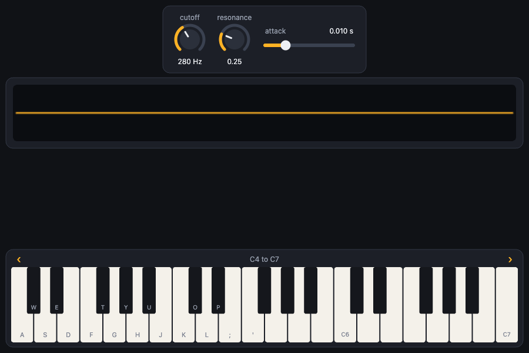
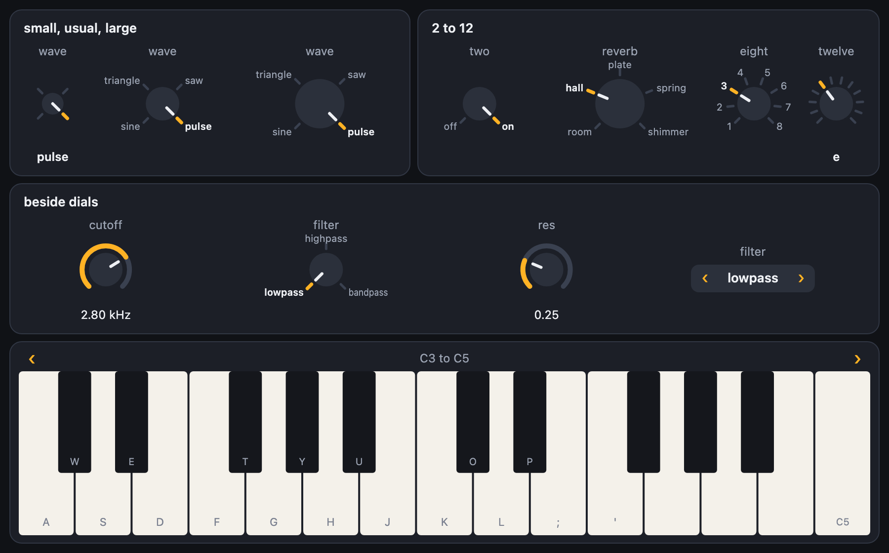
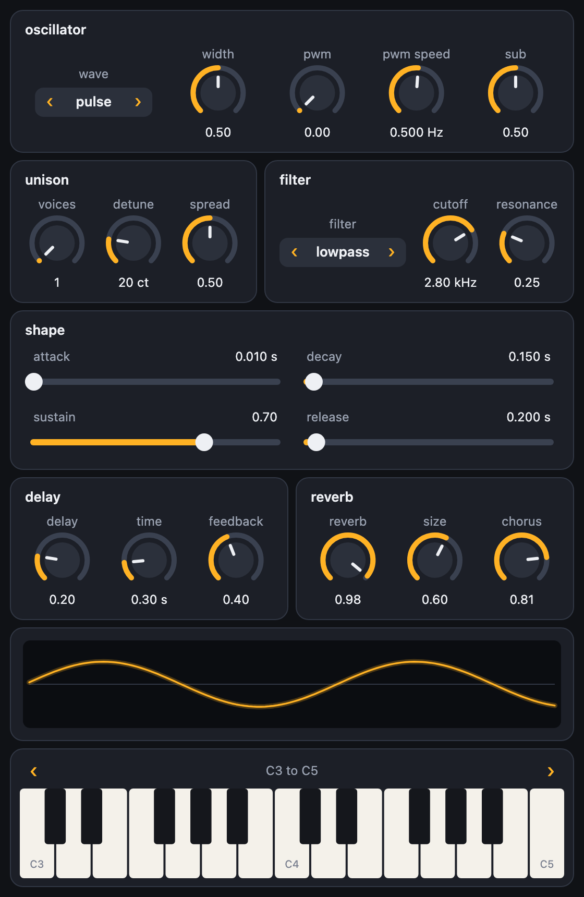
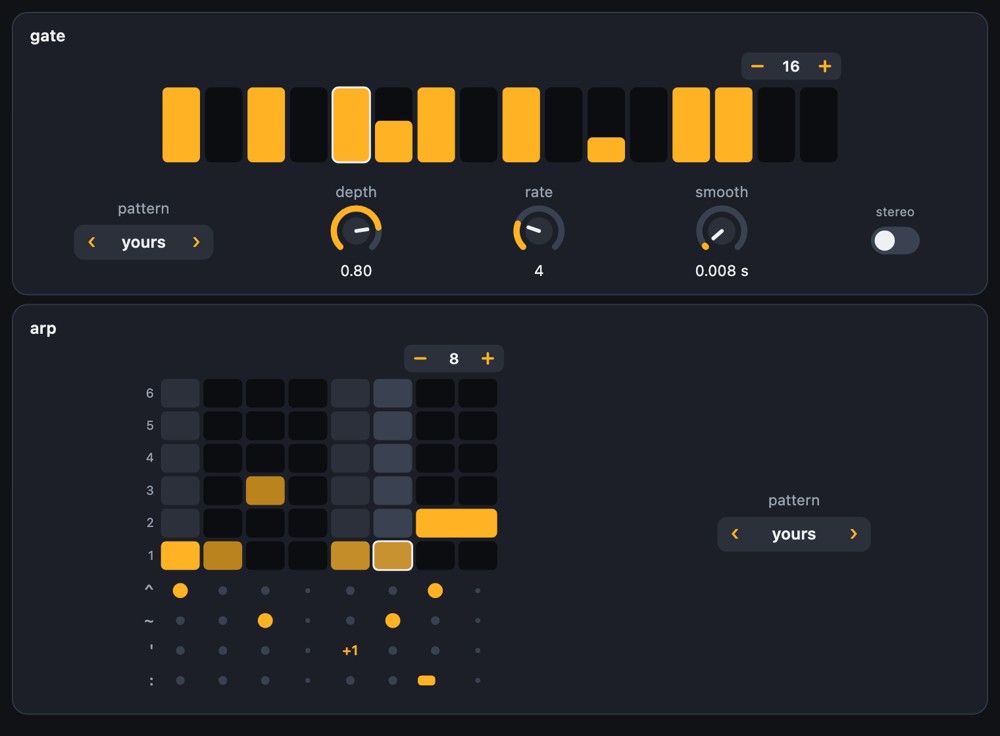
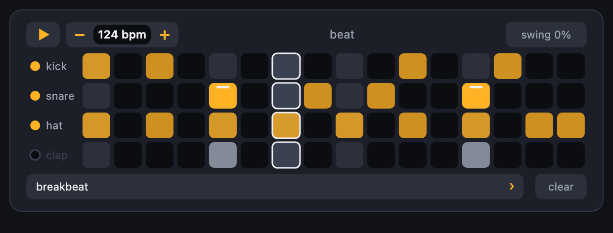
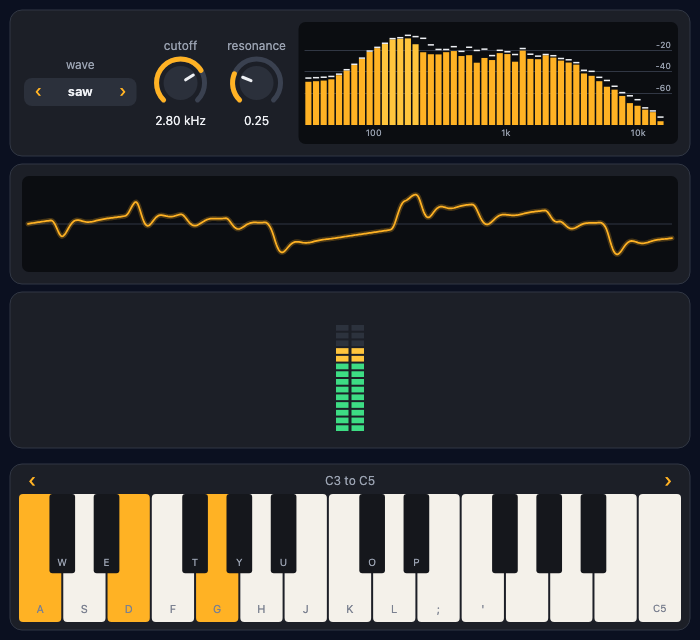
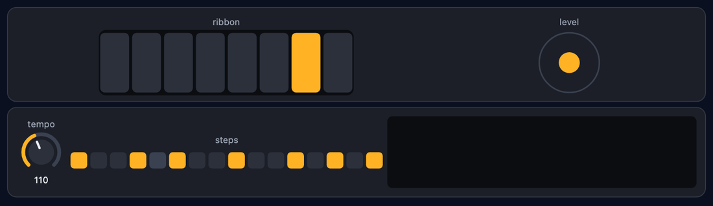
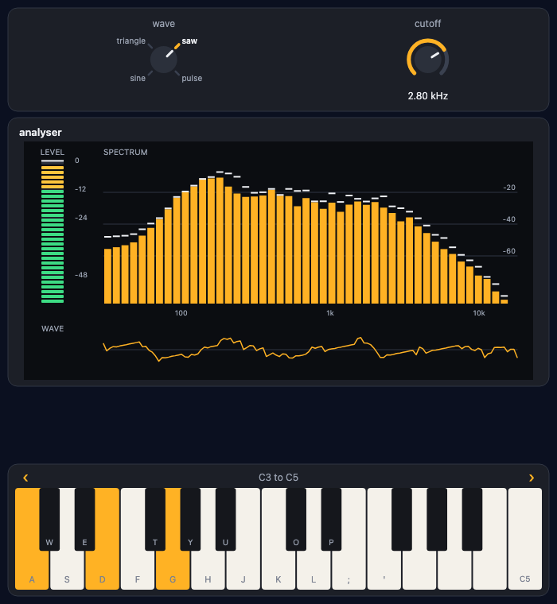
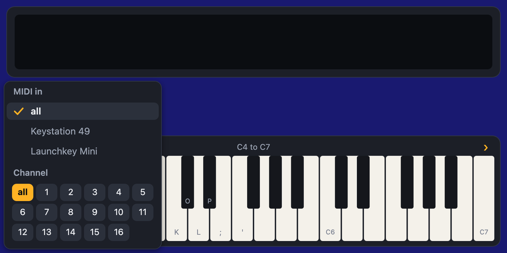

# Dials and a keyboard

A scene can have dials, sliders, buttons, a piano keyboard, a scope and level meters on it. You say what you want and it appears: nothing to position, nothing to draw. They work with a finger (several at once on the keyboard), with the mouse and with the computer's keys. The library is called **pydials**, and it comes with Pyctures. One line at the top of the scene brings its functions in:

```python
from pydials import *

points = dial("points", 3, 12, 5, step=1)     # from 3 to 12, starting at 5
size = slider("size", 40, 160, 110)

def draw():
    background("midnightblue")
    star(width / 2, height / 2 + 30, size, points, "gold")
```

A control stands for its number wherever a number is wanted: `star(..., size, points, ...)`, `speed * dt`, `if mute:`. `points.value` is the number itself, and `points.value = 8` sets it.

## A synth you can play

With [sound](sound.md), a dial can be a setting of a synth, and a keyboard plays it:

```python
from pyctures import *
from synths import *
from pydials import *

lead = make_synth("lead")
dial("cutoff", lead, "cutoff")
dial("resonance", lead, "resonance")
slider("attack", lead, "attack")
scope(lead)
keyboard(lead, octave=4)
```



Each dial takes its range, its unit and where it starts from the synth, and turning it changes the sound as you hear it. The scope draws the wave the synth is making. The keyboard plays it: with fingers, with the mouse, and with the keys A S D F G H J (the white keys) and W E T Y U (the black ones); Z and X step down and up an octave.

A key sounds the moment it is touched, however busy Python is, because the page plays the synth itself. Python is told afterwards: `lead.cutoff` reads what the dial says, and `piano.notes` what is held.

`scope(sound_output())` and `meter(sound_output())` show all the sound together, and `dial("volume", sound_output(), "volume")` turns it up and down.

## The controls

All of them take `x=` and `y=` (to place it by hand: its top left corner), `colour=`, `size=`, `share=` and `span=`.

| Call | What it makes |
|---|---|
| `dial(label, min, max, start)` | A dial. Also `step=`, `unit=`, `log=True` (turned by ratio, as a pitch is), `size=`, `on_change=` |
| `dial(label, target, "setting")` | A dial that is a setting of a target, such as a synth |
| `slider(...)` | The same as a dial, as a slider. `vertical=True` stands it upright |
| `button(label, on_press)` | A button. `fire.pressed` is true once for each press (ask it in `update`); `fire.held` while it is down |
| `toggle(label, on)` | A switch: `if mute:` |
| `rotary(label, choices, start)` | A knob that clicks between a few choices, with a notch for each and their names round it where there is room. Drag to turn it from notch to notch, or tap a name. `mode.value` is the choice. `rotary("reverb", lead, "reverb_type")` takes the choices from the synth. The choice is written under the knob only where no names are round it; `show_value=True` or `False` says otherwise |
| `select(label, choices, start)` | One of a list, stepped through with the arrows at its sides. `wave.value` is the choice. `select("wave", lead, "wave")` takes the choices from the synth, and keeps up when they change (`"sample"` is a wave only once the synth has a sample). `style="rotary"` makes it a rotary |
| `keyboard(target, octave=4)` | A piano keyboard along the bottom. `piano.notes` is what is held now (60 is middle C). `midi=True` adds a MIDI button: [see below](#the-midi-button). `on_note_on=` is given the note and how hard. Also `octaves=`, `height=`, and `animate=False` (the keys jump to a new octave, not slide) |
| `scope(source)` | A line of numbers, live: a synth's wave, or with no source, `graph.push(value)` draws any value over time |
| `spectrum(source)` | The frequencies in a sound as bars, low to high from the left, spaced as notes are: a synth, a function that returns a list of numbers, or a list. Options: `bands=` (32), `peaks=False`, `rate=` (48000): see [Spectrum](#spectrum) |
| `meter(source)` | A level from 0 to 1 as a bar of lights |
| `custom(label, draw=..., on_down=..., on_move=..., on_up=..., source=..., design=...)` | A control of your own: see [Your own controls](#your-own-controls) |
| `label(text)` | Words. Made just before some controls, it is their heading, on the plate they share |
| `group`, `row`, `column`, `grid`, `page`, `spacer`, `wrap` | What goes with what: see [Laying it out](#laying-it-out) |
| `number`, `text_box`, `readout`, `checkbox`, `choose`, `radio`, `dropdown`, `xy_pad`, `colour_picker`, `progress`, `light`, `busy`, `range_slider`, `fader`, `joystick`, `dpad`, `action_button`, `envelope`, `step_grid`, `pads`, `pitch_wheel`, `mod_wheel`, `steps`, `trance_gate`, `arp_pattern`, `drum_seq` | More controls, for any program, for games and for music: see [More controls](#more-controls) |
| `layout(at="bottom")` | Where the plates go (`"top"`, `"bottom"`, `"left"`, `"right"`), and `scale=`, `wrap=`, `fit=`, `min_scale=`, `max_scale=`, `columns=`, `size=`, `compact=`, `dividers=`, `plates=`, `align=`, `backdrop=`, `image=` and `on_resize=`. `layout()` gives back the width, height and scale the page last said |
| `room()` | The rectangle no control is on (`x`, `y`, `width`, `height`), for the scene to draw in. The page says it with a frame, so it is a frame late |
| `theme(accent="deepskyblue")` | The colours |

Every control has `value`, `remove()` and `place(x, y)`.



## With your hands

- Drag up or to the right on a dial to turn it up. The drag is the dial's until you let go, wherever the pointer wanders.
- Hold Shift to turn a tenth as far. On a touch screen, pull your finger well away from the dial for a quarter.
- Tap twice to put a dial or slider back where it started.
- Tap a slider's track and the handle comes to your finger.
- Each finger on the keyboard holds its own key, and sliding along plays each key in turn.
- The arrows above the keys step an octave, again and again while one is held, and the keys slide there. A finger on the strip between the arrows drags the keys sideways, and they settle on a whole octave.
- A rotary holds at each notch until you have gone most of the way to the next, then clicks over. Tap a name or a notch to go straight to it.
- When there is more than fits, drag a plate's title, or the room between controls, to move the plates. A drag that starts on a dial still turns the dial.
- On a touch screen the controls are made a little bigger, for fingers.

## Laying it out

**There is nothing to do.** Controls line up in the order you make them, on a plate, with the keyboard along the bottom. On a narrow screen the line wraps evenly (six dials are three and three, never five and one), on a touch screen everything is a little bigger, and when the picture changes size it is all laid out again. Controls are drawn a little smaller before a line has to wrap, but never tiny: when there is more than fits, the plates can be moved: with a finger (they carry on a little when it lets go), the mouse wheel, a trackpad or the thin bar beside them, while the keyboard and the scope above it stay where they are. A drag that starts on a dial turns the dial; one that starts on a plate's title, on words or between the plates moves them, passing over dials without turning any; and on a slider that lies across, a finger going along it moves the slider and one going up or down moves the plates. The keyboard is the instrument, and keeps its height: when the plates, the scope and the keyboard do not all fit, the scope is made shorter (never too short to read a wave), and if that is not enough it is the plates that are moved, under a scope and a keyboard that stay where they are. Only on a phone on its side, where there is hardly any height, does the keyboard give up some of its own and the scope go away. `keyboard(lead, height=200)` is kept to, whatever the room.

**A label is a heading.** A `label` made just before some controls is the title of their plate, and they are kept together: a plate moves to the next line whole, never leaving its heading behind. Plates with titles fill the width: they stand side by side, as many to a line as fit, every line reaching both edges, and `row()` says where a line should end when one has to. This is a whole synth panel, and it needs nothing else:

```py
label("oscillator")
select("wave", lead, "wave")
dial("width", lead, "width")

row()
label("unison")
dial("voices", lead, "voices")
dial("detune", lead, "detune")
label("filter")
dial("cutoff", lead, "cutoff")
dial("resonance", lead, "resonance")
```



**Groups.** `group` says the same thing out loud, and takes options. What is made inside `with` is in the group:

```py
with group("filter"):
    dial("cutoff", lead, "cutoff")
    dial("resonance", lead, "resonance")
```

Or in a straight line, with nothing to indent: `group("filter")` and then its controls, until the next `group`, `row()` or `page`. The plates of a line share its width and are as tall as each other, and every line is as wide as the others, so the panel looks made rather than poured. This is a whole synth in seven groups:


**Inside a group**, controls stand in a line. To arrange them another way, put these in it (they nest):

| | |
|---|---|
| `with row():` | In a line. (`row()` alone starts a new line.) |
| `with column():` | One under another. |
| `with grid(3):` | Three to a line, in columns that line up; fewer where three will not fit. `span=2` on a control covers two columns. |
| `spacer()` | All the room that is left over, so what follows is pushed to the far end. `spacer(20)` is 20 points. |
| `size="small"`, `"large"`, `1.5` | On any control: smaller, larger, or so many times the usual size. A dial, slider and meter also take a size in points (a number over 4). |
| `share=1` | On a control or a group: it takes the room its line has left over. Two things with shares of 2 and 1 split the line two to one. |

A group takes `colour=` (for its title and every control in it), `columns=3` (a grid), `gap=`, `align=` (`"start"`, `"center"`, `"end"`; left out, its controls are spread along the line), `dividers=True` (a line between the groups inside it) and `plate=False`.

```py
with group("filter", colour="deepskyblue"):
    with column():
        select("kind", lead, "filter")
        toggle("sync", lead, "sync")
    with grid(2):
        dial("cutoff", lead, "cutoff", size="large", span=2)
        dial("resonance", lead, "resonance", size="small")
        dial("chorus", lead, "chorus", size="small")
```

### Size and fit

**By itself**, a panel fits whatever it is on. On a phone held upright its plates are one to a line and are moved up and down with a finger, under a keyboard that stays put. In a tablet's split view they are two to a line, and across a whole tablet three or four, each line reaching both edges. On a touch screen everything is a little bigger, and nothing is ever drawn too small for a finger. Three lines change that: `layout(scale=1.3)`, `layout(wrap=False)` and `layout(size=(900, 640))`.

**Bigger or smaller.** `layout(scale=1.3)` draws everything that much bigger, and it works with everything below.

**Fit the width.** `layout(wrap=False)` keeps every row exactly as you wrote it (each `row()` is one row, whatever the screen) and draws the whole panel smaller until the widest row fits the width. There is one scale for the whole panel, set by that widest row, so a knob is the same size on every row.

```py
layout(wrap=False)
label("oscillator"); select("wave", lead, "wave"); dial("width", lead, "width"); dial("pwm", lead, "pwm"); dial("sub", lead, "sub")
row()
label("unison"); dial("voices", lead, "voices"); dial("detune", lead, "detune"); dial("spread", lead, "spread")
label("filter"); select("filter", lead, "filter"); dial("cutoff", lead, "cutoff"); dial("resonance", lead, "resonance")
row()
label("shape"); slider("attack", lead, "attack"); slider("decay", lead, "decay"); slider("sustain", lead, "sustain"); slider("release", lead, "release")
row()
label("delay"); dial("delay", lead, "echo"); dial("time", lead, "echo_time"); dial("feedback", lead, "echo_feedback")
label("reverb"); dial("reverb", lead, "reverb"); dial("size", lead, "reverb_size")
scope(lead)
keyboard(lead)
```

`layout(fit="width")` is the same, and also draws the panel bigger where there is room to spare, so that the widest row reaches both edges: no bigger than `max_scale=` (1.6 unless you say), and no bigger than still fits the height.

Under a finger the panel is not drawn smaller than eight tenths of its size, which is as small as is comfortable to touch (with a mouse, half). If the rows are still too wide they are left that size and moved from side to side. You choose the floor: `layout(wrap=False, min_scale=1)` never shrinks at all, and `min_scale=0` shrinks as far as it takes.

**A panel of a set size.** `layout(size=(900, 640))` lays the panel out once, as if every screen were 900 by 640, and then makes the whole of it bigger or smaller to fit the screen it is on, keeping its shape and standing in the middle. Nothing moves about from one screen to the next: only the size changes. A width alone, `layout(size=900)` (or `fit="width"` beside a size), fills the width instead, and what does not fit is moved up and down. `x` and `y` are measured in the same size.


A panel made for a tablet is small on a phone. One more line gives the phone its own:

```py
layout(wrap=False) if layout().width < 600 else layout(size=(900, 640))
```

**A bigger knob is your choice, and it is kept.** `size="large"`, `"small"`, or a number of times the usual size (`size=1.5`) on any control makes it that much bigger than its neighbours on every screen and at every scale. Its label and its value still line up with theirs.

```py
layout(wrap=False)
with group("filter"):
    rotary("kind", lead, "filter")
    dial("cutoff", lead, "cutoff", size="large")
    dial("resonance", lead, "resonance")
    dial("drive", lead, "drive", size="small")
with group("mix"):
    dial("volume", lead, "volume", size=1.5)
    dial("pan", lead, "pan")
```


### Controlling wrapping

Say nothing and the panel decides. Say something and it does as it is told.

| | |
|---|---|
| `layout(wrap=False)` | Never wrap. Every row is the row you wrote, drawn smaller to fit the width (see above). |
| `layout(wrap=True)` | Every `row()` starts a new line, and a row is split only when it does not fit. |
| `layout(columns=3)` | Three plates to a line, always. |
| `layout(columns={"phone": 1, "tablet": 2, "wide": 3})` | How many at each width. `phone` is any width, `tablet` 600 points and up, `wide` 900 and up; a number is a width of your own: `{0: 1, 700: 3}`. |
| `with group("shape", wrap=False):` | This group's controls stay on one line, whatever the width. |
| `with row(wrap=False):` | Groups made inside stay side by side. |
| `row()` | A new line starts here. Inside a group too. |
| `wrap()` | If this line has to be split, split it here. Nothing happens while it fits. |

When a row that may not wrap is too wide, the whole panel is drawn smaller, not that row alone: one scale, as above. Left to itself, a panel treats a `row()` between two plates with titles as the place to end a line when a line must end, and puts as many plates on a line as fit.

```py
layout(columns={"phone": 1, "tablet": 2, "wide": 3})
```


```py
with group("shape"):
    slider("attack", lead, "attack")
    slider("decay", lead, "decay")
    wrap()                                # split here, if it must be split: never between sustain and release
    with row(wrap=False):
        slider("sustain", lead, "sustain")
        slider("release", lead, "release")
```

**Arranging it yourself.** `layout()` gives back what the layout came to: `layout().width`, `.height` and `.scale`. `layout(on_resize=fn)` is called when the picture changes size, with the same three, so a scene can take everything away and make another arrangement. The page tells Python these with a frame: in a scene’s very first lines the scale is still 1.

### Pages, edges and exact places

**Pages.** When there is too much for one screen, give it pages. Each has a tab; the keyboard, and what is made before the first page and after the last, stay on every page.

```py
page("osc")
group("oscillator")
select("wave", lead, "wave")
dial("width", lead, "width")
page("filter")
group("filter")
dial("cutoff", lead, "cutoff")
dial("resonance", lead, "resonance")
page()                      # the pages end here
scope(lead)
keyboard(lead)
```

`with page("fx") as fx:` works too, and `fx.show()` turns to a page from your code.


**Along an edge, and the room that is left.** `layout(at="bottom")` puts the plates at the bottom, and `"left"` or `"right"` in a column down that side. One group can be a strip along an edge, and `room()` is the rectangle no control is on, for the scene to draw in:

```py
with group("moves", at="left"):
    speed = dial("speed", 0, 10, 4)
    jump = button("jump")
    spacer()
    trail = toggle("trail")
with group(at="bottom"):
    button("left")
    button("right")
    spacer()
    button("fire", size="large")

def draw():
    area = room()                         # its x, y, width and height
    rect(area.x, area.y, area.width, area.height, "steelblue")
```

The page works the rectangle out and tells Python with a frame, so in the scene's very first lines `room()` is still the whole picture.


Nothing here asks Python anything: each line above is one command to the page, and the page decides where things go.

**Exactly where you say.** `x=` and `y=` on a control or a group place its top left corner, and `control.place(x, y)` moves it. With `layout(size=(800, 480))` those numbers are in a panel 800 by 480 that is scaled to fit the picture, so a front panel drawn once is right on every screen:

```py
layout(size=(800, 480), image="panel.png")              # a picture behind the controls
dial("cutoff", lead, "cutoff", x=360, y=30, size="large")
with group("osc", x=20, y=20, width=300):
    select("wave", lead, "wave")
    dial("sub", lead, "sub")
keyboard(lead, x=20, y=340, width=760, height=120)
```

**The look.** `layout` also takes `compact=True` (less room around everything), `dividers=True`, `plates=False` (no plates: a picture of your own behind), `backdrop=` (a colour), `image=`, `align="center"` (plates keep their own widths) and `scale=`. `theme(accent="deepskyblue", plate="#20242c")` is still one call for the colours.

A whole program, to run as it is:

```python
from synths import *
from pydials import *

lead = make_synth("lead")

with group("oscillator"):
    rotary("wave", lead, "wave")
    dial("pwm", lead, "pwm")
with group("filter"):
    dial("cutoff", lead, "cutoff", size="large")
    dial("resonance", lead, "resonance")
with group("reverb"):
    rotary("space", lead, "reverb_type")
    dial("reverb", lead, "reverb")
scope(lead)
keyboard(lead, octave=4)

def draw():
    background("midnightblue")
    area = room()                         # the rectangle the controls leave
    circle(area.x + area.width / 2, area.y + area.height / 2, 10 + 200 * max(lead.level()), "gold")
```

## More controls

These are made and laid out like the ones above, are numbers or words in your code in the same way, and take the same options. The page draws them and feels the fingers, typing included; Python has what changed with the next frame.

### For any program


```py
lives = number("lives", 0, 9, 3)            # − and +, or tap the number and type
name = text_box("name", "Ada")              # tap it and type
score = 0
readout("score", lambda: score, size="large")

def draw():
    background("midnightblue")
    text(f"{name} has {lives} lives", 20, 120, "white", 20)
```

| | |
|---|---|
| `number(label, min, max, start)` | A number box. Tap − or + to step, hold one to keep stepping (faster and faster), drag up or down on the number, or tap the number and type it. It counts in ones (in tenths over a small range) unless `step` says otherwise. `number(label, target, "setting")` ties it to a setting. `stepper` is the same. |
| `text_box(label, text)` | One line of text. Tap it and type: Enter keeps what you typed, Escape puts back what was there. `name.value` is the text. Options: `placeholder`, `max` (letters), `width`, `on_change(text)` (as each letter is typed; Python hears it a frame later), `on_enter(text)`. `text_box(label, target, "setting")` ties it to a setting. |
| `readout(label, lambda: value)` | Shows a value or a message, and takes no hand. Give it a function (asked every frame), a target and a setting, or nothing: then `score.value = 12` says what it shows. Options: `unit`, `digits`, `size=` (`"large"` for a score), `format="clock"` (65 is 1:05) or a function that makes the words. |


```py
sound = checkbox("sound", True)                             # if sound: …
mode = choose("mode", ["easy", "medium", "hard"])           # mode.value, mode.index
planet = dropdown("planet", ["Mercury", "Venus", "Earth", "Mars", "Jupiter", "Saturn"], "Earth")
```

| | |
|---|---|
| `checkbox(label, on)` | A box that is ticked, with its label beside it. `sound.on` is True or False, as a toggle's is. `checkbox(label, target, "setting")` ties it to a setting. |
| `choose(label, choices, start)` | One of a few, all in sight side by side: tap one, or slide a finger across them. `mode.value` is the choice and `mode.index` its place. Where they do not fit on one line they take two. `choose(label, target, "setting")` takes the choices from the target. |
| `radio(label, choices, start)` | The same, one under another with a round mark each. |
| `dropdown(label, choices, start)` | One of a long list. A tap opens the whole list over the controls; a long one is moved with a finger or the wheel; it closes on a pick or a touch outside it. |


```py
pad = xy_pad("filter", lead, "cutoff", "resonance")     # one finger, two settings
ink = colour_picker("ink", "tomato")
price = range_slider("price", 0, 100, [20, 80])
bar = progress("loading")
t = 0

def update(dt):
    global t
    t += dt
    bar.value = t / 10                                  # from 0 to 1

def draw():
    background("midnightblue")
    circle(width / 2, height / 2, 60, ink.value)        # a colour, as you would write one
```

| | |
|---|---|
| `xy_pad(label, target, "across", "up")` | A square where one finger sets two numbers at once: across is the first and up is the second. `pad.x` and `pad.y` are the numbers, and `pad.value` is both. `xy_pad(label, [0, 100], [0, 50])` is two plain ranges, starting in the middle (a third number in a range says where). The dot comes to your finger; Shift moves it a tenth as far; two taps put it back. Options: `spring=True` (it goes back when you let go), `size=`, `on_change(x, y)`. |
| `colour_picker(label, colour)` | A patch of the colour. A tap opens a picker: drag in the square for how strong and how bright, along the strip for the hue, or tap one of sixteen named colours. `ink.value` is the colour as you would write it (`"tomato"`, `"#3a7bd5"`), ready for a drawing call. Options: `colours=` (your own named colours, or `False` for none), `on_change(colour)`. `color_picker` is the same. |
| `progress(label, value)` | A bar that fills, from 0 to 1 (or `min=` to `max=`). Set `bar.value`, or give it a function: `progress("loading", lambda: done / total)`. `percent=False` leaves the number out. |
| `light(label, on)` | A light. `ready.on = True`; a number from 0 to 1 is how bright; a colour (`lamp.value = "red"`) shines that colour. `light("signal", lead)` is as bright as a target is loud, and `light("hot", lambda: heat > 90)` asks a function. |
| `busy(label)` | A ring that goes round while something is happening; `wait.on = False` stops it. |
| `range_slider(label, min, max, [low, high])` | A slider with two handles. `price.low` and `price.high` are the numbers. The handle nearer your finger moves, and neither passes the other. `range_slider(label, target, "start", "end")` is two settings. `on_change(low, high)`. |
| `fader(…)` | A slider that stands upright with the look of a mixing desk's. It is a slider in every other way: `fader("volume", lead, "volume")`. |


**Typing.** A canvas cannot be typed into, so while you type a real box for text lies over the control: your device's own keyboard, caret, selection and paste all work. On a phone or tablet the keyboard comes up when your finger lifts, and a number asks for the number keys. What you type goes to the box and not to the scene's `keys`. It works the same when the picture is drawn smaller or larger, when the page is scrolled, and when the scene is shut inside a frame (as a preview's is): nothing is asked of the page around it.

**Keys.** The control you touched last takes the arrow keys: on a number box they step it (Shift ten at a time, Home and End go to the ends, Enter types). Space ticks a checkbox, the arrows move among choices, and on a dropdown Enter opens the list, the arrows move through it, Enter picks and Escape closes. The arrows move an XY pad's dot and the handle of a two-handled slider that was touched last. Tab goes to the next control that takes keys.

### For games


```py
stick = joystick()
fire = action_button("A")
x, y = 200, 200

def update(dt):
    global x, y
    x += stick.x * 300 * dt                  # each from -1 to 1, and 0 when you let go
    y += stick.y * 300 * dt
    if fire.pressed:
        shoot()
```

Each finger holds its own control, so one thumb steers while the other fires.

| | |
|---|---|
| `joystick()` | A stick for a thumb, which springs back when you let go. `stick.x` and `stick.y` are each from -1 to 1 in the scene's own directions (y goes down the picture, so `y += stick.y * speed` goes where the thumb pushes). `stick.angle` is the way it is pushed (in radians) and `stick.distance` how far, from 0 to 1. Options: `floating=True` (it appears where the thumb lands, anywhere in its box: give `width=` and `height=`), `as_keys=True`, `size=`, `on_change(x, y)`. |
| `dpad()` | A pad of arrows. `pad.left`, `pad.right`, `pad.up` and `pad.down` are True while pressed, and `pad.x` and `pad.y` are -1, 0 or 1. A thumb slides from one arrow to the next; between two, both are pressed, unless `ways=4`. |
| `action_button("A")` | A round button: `fire.pressed` is True once for each press and `fire.held` while it is down, as for any button. `key="space"` holds that key down for the scene while it is pressed. |

**A game written for the keyboard, on a phone.** `dpad(as_keys=True)` holds the arrow keys down for the scene (`"wasd"` for those keys), so a game that asks `"ArrowLeft" in keys` is played by touch with not a line changed:

```py
dpad(as_keys=True)
action_button("jump", key="space")

def update(dt):
    global x
    if "ArrowLeft" in keys: x -= 300 * dt    # the keyboard, or the pad
    if " " in keys: jump()
```

For a game, put the controls in a strip and draw in the room that is left: `with group(at="bottom", plate=False):` and `room()`.

### For music


```py
lead, kick = make_synth("lead"), make_synth("kick")
envelope("shape", lead)                                 # lead's attack, decay, sustain and release
grid = step_grid("drums", 16, ["kick", "snare", "hat"])
kit = pads("kit", ["kick", "snare", "hat", "clap"], kick)
last = -1

def update(dt):
    global last
    step = int(beat() * 4) % 16                         # sixteen steps to four beats
    if step != last:
        last = grid.step = step                         # light the column that is playing
        if grid.get("kick", step):
            kick.play("C2")
```

| | |
|---|---|
| `envelope(label, target)` | How a note begins, settles, holds and dies away, as a graph whose corners you drag: the first sets the attack, the second the decay (across) and the sustain (up and down), the last the release. It finds the target's `attack`, `decay`, `sustain` and `release` by those names, or takes the four names: `envelope("shape", lead, "a", "d", "s", "r")`. With no target, `shape.attack` and the rest are numbers to use. Two taps put it back; `on_change(attack, decay, sustain, release)`. |
| `step_grid(label, steps, rows)` | A grid of steps, each on or off: a row for each sound. A tap turns a step over, and a finger dragged along turns on (or off) every step it crosses. `grid.value` is the rows, each a list of 0 and 1; `grid.get("kick", 0)` reads one step and `grid.put("kick", 0)` writes one; `grid.row("kick")`, `grid.clear()`. `grid.step = 3` lights that column as the one playing. On a narrow screen a long row is put on two lines. Options: `value=` (the rows to start with), `velocity=True` (drag up or down on a step for how hard, 0 to 1), `on_change(row, step, on)`. |
| `pads(label, names, target)` | Pads to hit, several at once. Each plays a note of the target for as long as it is held (`note_on(note, velocity)`, `note_off(note)`), harder the nearer its middle it is hit. Pads named for drums play those drums' notes (a kick is 36, a snare 38, a hat 42); others count up from 36, or are told with `notes=`. `kit.held` is the names of the pads held now; `kit.flash("kick")` lights one from your code; `kit.hit("kick")` and `kit.lift("kick")` play one. Options: `notes=`, `columns=`, `size=`, `on_note_on(note, velocity, name)`, `on_note_off(note, name)`. |
| `pitch_wheel(label, target, "setting")` | A wheel that is rolled, and rolls back to where it started when you let go. Alone, `bend = pitch_wheel("bend")` runs from -1 to 1. |
| `mod_wheel(…)`, `wheel(…)` | The same wheel, which stays where it is put (`spring=True` makes it roll back). Both are sliders in every other way. |

**Patterns: a gate, an arpeggio and a drum sequencer.**



```py
from synths import *

set_tempo(138)
pad, lead = make_synth("pad"), make_synth("lead")
pad.trance_gate = "trance"                              # a pattern by name, or "x.x.xx.x"
trance_gate("gate", pad)                                # draws pad.trance_gate, to change by hand, with its depth, rate and the rest beside it
arp_pattern("arp", lead)                                # draws lead.arp_pattern
pad.start(["A3", "C4", "E4"])                           # a held chord, chopped by the gate
lead.start_arp("Am7", step="sixteenth")                 # an arpeggio that follows the pattern

mine = trance_gate("chop", "x.x.x5x.x.3.xx..")          # or a pattern of your own, tied to nothing: mine.value, mine.text
```

| | |
|---|---|
| `trance_gate(label, target)` | The steps that open and shut a sound in time, each a bar as tall as the gate is open. Tap a bar on and off, drag up and down on it for its level, drag across to draw a line of them. The − and + at its corner set how many steps (up to 32). `gate.preset("pump")` writes a built-in pattern: eighths, offbeat, gallop, trance, stutter, pump, triplets, dotted. |
| `arp_pattern(label, target)` | An arpeggio's pattern: steps across, and the notes of the chord up the side. 1 is its lowest, and past its top note the count goes on an octave up, so on a chord of four notes row 5 is the lowest again, an octave higher. Tap a cell and that step plays that note; tap it again for a rest; drag sideways from it and the note is held across the next steps. Under the grid is a lane for each other thing a step has: tap for an accent (`^`), tap for a slide into the note (`~`), tap to go round the octaves (`'`), and drag up and down for the step's own length (`:`). `arp.preset("trance")` writes a built-in pattern: bounce, octaves, root-fifth, thumb, converge, diverge, offbeat, gallop, trance, acid. Options: `notes=` (how many rows of notes to start with, 8), `steps=`. |
| `steps(label, 16)` | The lane of steps that the two above, and a row of a grid, are made of, to use for anything: a row of accents, a setting that changes each step. Tap and drag across; `levels=True` makes each a bar, `accents=True` gives an accent to a step you drag up on. `steps(label, target, "setting")` ties it to a setting. |
| `drum_seq(label, drums, target)` | A drum sequencer that plays by itself: see below. |

Each has `value` (a list: levels from 0 to 1 for a gate or a lane, and for an arpeggio a step each, a dict with `note`, `octave`, `tie`, `accent`, `slide` and `length`, where note 0 is a rest and length 0 is the arpeggio's own), `text` (the same as text), `length`, and `step`: set `gate.step = 3` and that step is lit as the one sounding. Any of `value` and `text` may be set, to a list, to text or to a built-in pattern's name, and `on_change(value)` hears a hand, a frame later.

**As text**, a pattern is exactly what the sound engine reads ([synths.js](https://github.com/johnwylie70/synths.js), and a song's file), so it can be saved, pasted into your code and handed to a synth:

| | |
|---|---|
| a gate | one mark a step: `.` off, `x` on, `1` to `8` on at that many ninths (`0` is off and `9` is on). Spaces are for the eye: `"x...x... x.5.x..."`. A gate has no accents. |
| a drum's row, a lane, a row of a grid | the same marks and also `X`, on with an accent, and `\|` for the eye as well as a space. **This is not a gate pattern**, though it looks like one: it is this library's own, for a drum sequencer and a lane, and is not to be handed to a synth as its gate (nor a gate's text to a drum sequencer as a row with accents). |
| an arpeggio | steps with a space between: `1` `2` `3` that note of the chord, `-` (or `.`) a rest, `_` the note before held on; after a note `'` an octave up (`,` down), `^` an accent, `:1` to `:9` its own length in tenths of a step; before a note `~` slide into it: `"1 - 3 2 _ 1^ ~3 5':4"`. |

**Tied to a target**, a pattern is ONE setting of it: `tranceGate` and `arpPattern` on a synth (`trance_gate`, `arp_pattern` and plain `pattern` are looked for too, and you may name another). It is read and written as the target keeps it: as text if the setting is text (a synth's is, and is `""` when it has none), else as a list. `describe(name)` may say `steps` (the most there can be) and `patterns` (its own built-in patterns, by name). The step that is sounding is lit when the target says which: a synth's `tranceGateStep` and `arpStep` settings, or a `step()` or `position()` of the target's own. On the same plate go a `select` of the built-in patterns and, for a gate, the settings that go with it when the target has them (`tranceGateDepth`, `tranceGateRate`, `tranceGateSmooth`, `tranceGateSwing`, `tranceGateSends`, `tranceGateStereo`): a small dial for a number and a switch for one that is on or off. `beside=False` leaves them out. The marks of the text, the built-in patterns and the names looked for are each one small table in `dials.js` (`STEP_MARKS`, `ARP_MARKS`, `GATE_NAMED`, `ARP_NAMED`, `BESIDE`), and the marks and patterns again in `pydials`, so they are changed in one place each.



```py
kit = {"kick": make_synth("kick"), "snare": make_synth("snare"), "hat": make_synth("hat")}
beat = drum_seq("beat", ["kick", "snare", "hat"], targets=kit, notes=[36, 52, 60], pattern="backbeat", tempo=110)
```

`drum_seq` is a whole drum machine in one control. Tap a step on and off, drag across to paint, and drag up on a step for an accent. Tap a drum's name to hear it and the dot beside it to mute its row. Its own strip has play and stop, the tempo (− and +, or tap the number in time), swing, starter patterns (four on the floor, a backbeat, a breakbeat) and clear. On a phone it shows as many steps as fit a finger, a page at a time, and turns the page as it plays.

It plays whatever it is given: `target` (or `targets=`, a list or a dict by the drums' names) is anything with `note_on(note, velocity)`, and each row plays its drum's note (a kick is 36, a snare 38, a hat 42, a clap 39; `notes=` says otherwise). `on_step(drum, step, velocity)` hears every step that sounds. From code: `beat.play()`, `beat.stop()`, `beat.tempo`, `beat.swing`, `beat.pattern("breakbeat")`, `beat.mute("hat")`, `beat.get("kick", 0)`, `beat.put("kick", 0)`, `beat.value` (the rows) and `beat.text` (a line of marks for each drum).

**Keeping time.** The page plays the beat, not Python, so a target that lives in the page (a synth) is in time however busy Python is. If that target (or `clock=`) offers `time()`, in seconds, it is handed each step a little before it is due, as `noteOn(note, velocity, { at })`, to play at exactly that time; with no such clock a step is played on the frame it falls due, and the beat will wobble when the page is busy. A Python object given as a target is played a frame after its step.


A whole program with some of each, to run as it is:

```python
from synths import *
from pydials import *

lead, kick = make_synth("lead"), make_synth("kick")

with group("game"):
    lives = number("lives", 0, 9, 3)
    sound = checkbox("sound", True)
    mode = choose("mode", ["easy", "medium", "hard"])
    stick = joystick()
with group("music"):
    envelope("shape", lead)
    xy_pad("filter", lead, "cutoff", "resonance")
    grid = step_grid("drums", 8, ["kick", "hat"])
    pads("kit", ["kick", "snare"], kick)
    accents = steps("accent", 8)
with group("a drum machine in one line"):
    drum_seq("beat", ["kick", "snare", "hat"], kick, pattern="backbeat", tempo=110)
pad = make_synth("pad")
pad.trance_gate = "trance"
lead.arp_pattern = "bounce"
with group("patterns"):
    trance_gate("gate", pad)                # the pad's trance gate, drawn and edited
    arp_pattern("arp", lead)                # the lead's arpeggio pattern
bar = progress("time")
ready = light("ready", True)
x, t, last = 0.5, 0, -1

def update(dt):
    global x, t, last
    t += dt
    x = min(1, max(0, x + stick.x * dt))
    bar.value = (t / 10) % 1
    step = int(beat() * 2) % 8
    if step != last:
        last = grid.step = step
        if sound and grid.get("kick", step):
            kick.play("C2")

def draw():
    background("midnightblue")
    area = room()
    circle(area.x + x * area.width, area.y + area.height / 2, 8 + 4 * lives, "gold")
```

## A button in a game

```python
from pydials import *

jump = button("jump")
gravity = dial("gravity", 200, 2000, 900)
y, vy = 0, 0

def update(dt):
    global y, vy
    if jump.pressed and y == 0:
        vy = 500
    vy -= gravity * dt
    y = max(0, y + vy * dt)
    if y == 0:
        vy = 0

def draw():
    background("#182033")
    rect(0, height - 60, width, 60, "seagreen")
    circle(width / 2, height - 90 - y, 30, "gold")
```

## Spectrum

`spectrum(lead)` shows what is in a sound as bars, the low notes at the left. The bands are spaced the way notes are, from 30 Hz up, and a bar is as tall as the sound is loud in its band, from -90 dB to 0 dB (a full-strength sine reaches the top). A tick above each bar holds its highest point for a moment and falls.

```python
lead = make_synth("lead")
spectrum(lead, bands=48)
```



It takes what `scope` takes: a synth, a function that returns a list of numbers, or a list. `bands=` is how many bars (32), `peaks=False` leaves out the ticks and `rate=` (48000) is the sound card's rate. The page works the bars out, so in Python a synth in the page costs Python nothing.

## Your own controls

`custom` makes a control of your own: you draw it, and say what a finger does to it. It sits in the layout like any other control, has a `value` and an `on_change`, and can listen to a synth. Python sends what `draw` paints to the page as a list of shapes, so a control that changes only when touched costs nothing while it is still.



```python
from pyctures import *
from synths import *
from pydials import *

lead = make_synth("lead")

def draw_ribbon(c):                            # c.width, c.height, c.value, c.accent, c.theme; shapes in the control's own points
    c.rect(0, 0, c.width, c.height, c.theme["well"], 10)
    for i in range(8):
        c.rect(i * c.width / 8 + 3, 4, c.width / 8 - 6, c.height - 8, c.accent if i == c.value else c.theme["knob"], 6)

def down(p, c):
    ribbon.set(int(p.x / c.width * 8))
    lead.play(57 + ribbon.value, 0.4)

def move(p, c):
    i = int(p.x / c.width * 8)
    if i != ribbon.value:
        ribbon.set(i)

ribbon = custom("ribbon", width=340, height=110, value=-1, draw=draw_ribbon, on_down=down, on_move=move,
                on_up=lambda p, c: setattr(ribbon, "value", -1))

def draw_level(c):                             # source=lead gives draw c.level and c.samples
    c.circle(c.width / 2, c.height / 2, 14 + 26 * c.level, c.accent)

custom("level", width=80, height=110, source=lead, animate=True, draw=draw_level)
```

`height` is the drawing area (a label adds its own line above it, so `c.height` is the height you asked for). `on_down`, `on_move` and `on_up` get the finger's place in the control's own points (`p.x`, `p.y`), `on_frame(c, now)` is called every frame (to keep time), `on_key(event, c)` hears keys, and `animate=True` draws every frame. `ribbon.set(value)` is a change by hand (it calls `on_change`); `ribbon.value = x` and `ribbon.redraw()` only draw. The painter has `c.rect`, `c.frame`, `c.circle`, `c.ring`, `c.line`, `c.lines`, `c.polygon`, `c.text` and `c.clear`. The whole of it is in [pydials](https://github.com/johnwylie70/pydials#your-own-controls).

`design=(w, h)` is the size you draw for: `c.width` and `c.height` are then that, and what you draw is scaled to fit the control's box and centred in it, so a finger comes back in points of the design. `c.spectrum` is what a source is playing as `bands=` (32) bands, low to high, each from 0 to 1 for -90 dB to 0 dB, worked out in the page from the whole wave (Python's `c.samples` is thinned to at most 128 points, too few for that); `c.samples`, `c.level` and `c.input` are there too. A control is drawn on a layer of its own, the size of its area, so nothing it draws can be seen outside it: a shape far bigger than the box is cut at its edge. And it can be an analyser of your own:



```python
BANDS = 48
bars = [0.0] * BANDS

def paint_analyser(c):
    c.clear(c.theme["well"])
    for i in range(BANDS):
        v = c.spectrum[i] if c.spectrum and i < len(c.spectrum) else 0.0
        bars[i] = max(v, bars[i] - 0.02)                          # rise at once, fall away
        c.rect(100 + i * 520 / BANDS + 1, 24 + 180 * (1 - bars[i]), 520 / BANDS - 2, 180 * bars[i], c.accent)

custom(width=640, height=300, design=(640, 300), bands=BANDS, source=lead, animate=True, draw=paint_analyser)
```

## The MIDI button

`keyboard(lead, midi=True)` puts a MIDI button on the keyboard's strip. A tap makes the synth listen to MIDI (the browser asks first) and opens a panel for the device and the channel: every device or one, every channel or 1 to 16. It is the synth's own `lead.midi_input()`, so a choice made in code shows in the panel. With another target, or none, the keyboard listens to the browser's MIDI itself and keeps its own choice, so the button needs nothing.



Where the browser has no MIDI, the panel says so and the keyboard goes on working from the screen and the computer's keys.

## How it works

Python never touches the page: it may be in a worker, or on another computer. So the page draws the controls and feels the fingers, and a dial turns smoothly however busy Python is. Each function sends one command that makes the control in the page, and what a hand changes comes back with the next frame. The page loads the controls the first time a scene uses them; a scene without them loads nothing extra.

The library on its own, with every option, is [pydials](https://github.com/johnwylie70/pydials); the same controls for JavaScript are [dials.js](https://github.com/johnwylie70/dials.js).
