# Every effect

<!-- Written by scripts/effects_docs.py from the table in src/pyctures/web/visualfx/pyvisualfx.py. Do not edit it by hand. -->

This is the list. [Effects](effects.md) is how to use them. There are 94 effects and 16 looks, all from `from pyvisualfx import *`.

The value in the brackets is the one a plain number (or name) sets; every other setting goes in by name, `glow(0.8, radius=40)`, and can be changed at any time, `shine.radius = 60`. Every effect also has `amount`, from 0 to 1. Lengths are in the scene's points and angles in degrees; a place (`x`, `y`) is the middle unless you say.

The palettes: `rainbow`, `fire`, `ocean`, `sunset`, `neon`, `candy`, `forest`, `ice`, `lava`, `mono`, `thermal`, `aurora`, `gameboy`, `c64`, `amiga`, `pico`, or your own list of colours.

## Contents

- **Shapes of the picture**: [kaleidoscope](#kaleidoscope), [mirror](#mirror), [pixelate](#pixelate), [waves](#waves), [ripple](#ripple), [wobble](#wobble), [swirl](#swirl), [fisheye](#fisheye), [tunnel](#tunnel), [tile](#tile), [droste](#droste), [rotozoom](#rotozoom), [hexagons](#hexagons), [glass_tiles](#glass_tiles), [frosted](#frosted), [heat_haze](#heat_haze), [caustics](#caustics), [shake](#shake), [punch](#punch)
- **Blur and light**: [zoom_blur](#zoom_blur), [spin_blur](#spin_blur), [motion_blur](#motion_blur), [tilt_shift](#tilt_shift), [light_rays](#light_rays), [streaks](#streaks), [soft_focus](#soft_focus), [blur](#blur), [glow](#glow)
- **What was drawn stays**: [smear](#smear), [stutter](#stutter), [trails](#trails)
- **Colours**: [rgb_split](#rgb_split), [hue](#hue), [saturate](#saturate), [brighten](#brighten), [contrast](#contrast), [invert](#invert), [posterize](#posterize), [tint](#tint), [duotone](#duotone), [colour_cycle](#colour_cycle), [gradient_map](#gradient_map), [thermal](#thermal), [night_vision](#night_vision), [sepia](#sepia), [threshold](#threshold), [solarize](#solarize), [colour_bleed](#colour_bleed), [rainbow_edges](#rainbow_edges)
- **Screens and old computers**: [scanlines](#scanlines), [crt](#crt), [glitch](#glitch), [letters](#letters), [dither](#dither), [interlace](#interlace), [led](#led)
- **Drawn, printed and painted**: [edges](#edges), [dots](#dots), [emboss](#emboss), [sharpen](#sharpen), [sketch](#sketch), [cartoon](#cartoon), [stained_glass](#stained_glass), [crosshatch](#crosshatch), [oil](#oil)
- **In front of the picture**: [grain](#grain), [vignette](#vignette), [dust](#dust), [light_leaks](#light_leaks), [rain](#rain), [snow](#snow), [bokeh](#bokeh), [fog](#fog), [lightning](#lightning)
- **Backdrops that need no drawing**: [plasma](#plasma), [starfield](#starfield), [metaballs](#metaballs), [flow](#flow), [warp](#warp), [voronoi](#voronoi), [moire](#moire), [interference](#interference), [aurora](#aurora), [fire](#fire), [clouds](#clouds), [matrix_rain](#matrix_rain), [copper_bars](#copper_bars), [checker_floor](#checker_floor), [twister](#twister)
- **The music, drawn**: [spectrum_bars](#spectrum_bars), [spectrum_ring](#spectrum_ring), [waveform_ring](#waveform_ring), [beat_flash](#beat_flash), [bass_shake](#bass_shake)
- **Looks**: [dream](#look-dream), [arcade](#look-arcade), [vhs](#look-vhs), [neon](#look-neon), [comic](#look-comic), [underwater](#look-underwater), [oldfilm](#look-oldfilm), [disco](#look-disco), [gameboy](#look-gameboy), [c64](#look-c64), [noir](#look-noir), [comicbook](#look-comicbook), [storm](#look-storm), [winter](#look-winter), [cinema](#look-cinema), [terminal](#look-terminal)

## Shapes of the picture

### kaleidoscope

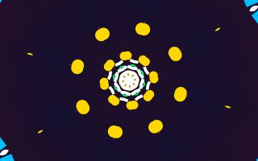

One slice of the picture, folded round and round. The slice starts at the middle and points right: turn it with angle.

```py
kaleidoscope(8)
```

| Setting | Starts at | Can be |
|---|---|---|
| `segments` | `8` | 2 to 32, a whole number |
| `angle` | `0` | -360 to 360 degrees |
| `zoom` | `1` | 0.2 to 5 |
| `x` | the middle | a place in the scene |
| `y` | the middle | a place in the scene |
| `amount` | `1` | 0 to 1 |

### mirror


One half of the picture shown on both sides, or one quarter in all four.

```py
mirror("left")
```

| Setting | Starts at | Can be |
|---|---|---|
| `side` | `"left"` | `"left"`, `"right"`, `"top"`, `"bottom"`, `"four"` |
| `amount` | `1` | 0 to 1 |

### pixelate

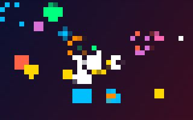

Big square pixels.

```py
pixelate(10)
```

| Setting | Starts at | Can be |
|---|---|---|
| `size` | `10` | 1 to 100 |
| `amount` | `1` | 0 to 1 |

### waves


The picture ripples like a flag in the wind.

```py
waves(12)
```

| Setting | Starts at | Can be |
|---|---|---|
| `size` | `12` | 0 to 100 |
| `length` | `160` | 10 to 1000 |
| `speed` | `0.5` | -5 to 5 |
| `amount` | `1` | 0 to 1 |

### ripple

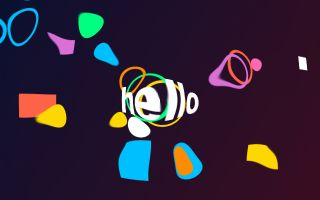

Rings spreading from a point, as from a stone dropped in water.

```py
ripple(8)
```

| Setting | Starts at | Can be |
|---|---|---|
| `size` | `8` | 0 to 100 |
| `length` | `60` | 10 to 1000 |
| `speed` | `1` | -5 to 5 |
| `x` | the middle | a place in the scene |
| `y` | the middle | a place in the scene |
| `amount` | `1` | 0 to 1 |

### wobble

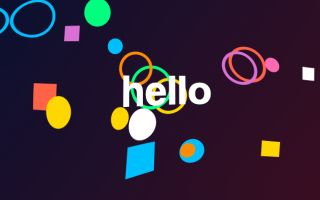

The picture wobbles like jelly, or something seen under water.

```py
wobble(14)
```

| Setting | Starts at | Can be |
|---|---|---|
| `size` | `14` | 0 to 100 |
| `scale` | `120` | 10 to 1000 |
| `speed` | `0.4` | -5 to 5 |
| `amount` | `1` | 0 to 1 |

### swirl

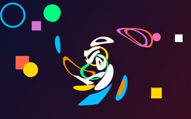

The middle of the picture twisted round, like stirred paint.

```py
swirl(180)
```

| Setting | Starts at | Can be |
|---|---|---|
| `angle` | `180` | -1440 to 1440 degrees |
| `radius` | `0` | 0 to 2000 |
| `x` | the middle | a place in the scene |
| `y` | the middle | a place in the scene |
| `amount` | `1` | 0 to 1 |

### fisheye


A bulge, as through a round lens. Below zero it pinches instead.

```py
fisheye(0.5)
```

Also called `bulge`.

| Setting | Starts at | Can be |
|---|---|---|
| `strength` | `0.5` | -1 to 1 |
| `radius` | `0` | 0 to 2000 |
| `x` | the middle | a place in the scene |
| `y` | the middle | a place in the scene |
| `amount` | `1` | 0 to 1 |

### tunnel

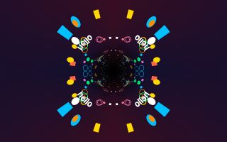

The picture becomes the walls of a tunnel you are flying down.

```py
tunnel(0.4)
```

| Setting | Starts at | Can be |
|---|---|---|
| `speed` | `0.4` | -5 to 5 |
| `repeat` | `2` | 1 to 12, a whole number |
| `depth` | `0.5` | 0.05 to 4 |
| `x` | the middle | a place in the scene |
| `y` | the middle | a place in the scene |
| `amount` | `1` | 0 to 1 |

### tile

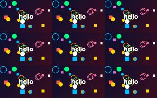

The picture repeated in rows and columns.

```py
tile(3)
```

| Setting | Starts at | Can be |
|---|---|---|
| `across` | `3` | 1 to 40, a whole number |
| `down` | `0` | 0 to 40, a whole number |
| `flip` | `False` | True or False |
| `amount` | `1` | 0 to 1 |

### droste

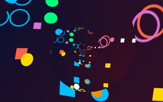

The picture inside itself, smaller each time, for ever. With a twist it winds in as a spiral.

```py
droste(3)
```

| Setting | Starts at | Can be |
|---|---|---|
| `zoom` | `3` | 1.2 to 10 |
| `twist` | `1` | 0 to 4, a whole number |
| `speed` | `0.3` | -5 to 5 |
| `x` | the middle | a place in the scene |
| `y` | the middle | a place in the scene |
| `amount` | `1` | 0 to 1 |

### rotozoom


The picture tiled, turning and zooming: an old demo-scene favourite.

```py
rotozoom(0.5)
```

| Setting | Starts at | Can be |
|---|---|---|
| `speed` | `0.5` | -5 to 5 |
| `zoom` | `1.5` | 0.2 to 8 |
| `amount` | `1` | 0 to 1 |

### hexagons


Six-sided pixels, like a honeycomb.

```py
hexagons(14)
```

| Setting | Starts at | Can be |
|---|---|---|
| `size` | `14` | 3 to 100 |
| `amount` | `1` | 0 to 1 |

### glass_tiles


Seen through a wall of glass blocks.

```py
glass_tiles(40)
```

| Setting | Starts at | Can be |
|---|---|---|
| `size` | `40` | 6 to 300 |
| `strength` | `0.4` | 0 to 1 |
| `amount` | `1` | 0 to 1 |

### frosted


Seen through frosted glass.

```py
frosted(6)
```

| Setting | Starts at | Can be |
|---|---|---|
| `size` | `6` | 0 to 60 |
| `amount` | `1` | 0 to 1 |

### heat_haze

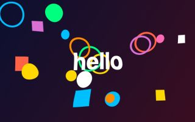

The shimmer of hot air rising.

```py
heat_haze(5)
```

| Setting | Starts at | Can be |
|---|---|---|
| `size` | `5` | 0 to 60 |
| `scale` | `40` | 5 to 400 |
| `speed` | `1` | -5 to 5 |
| `amount` | `1` | 0 to 1 |

### caustics


The net of bright lines that sunlight makes on the floor of a pool.

```py
caustics(0.5)
```

| Setting | Starts at | Can be |
|---|---|---|
| `strength` | `0.5` | 0 to 2 |
| `scale` | `120` | 20 to 600 |
| `speed` | `0.5` | -5 to 5 |
| `colour` | `"#bfe8ff"` | any colour |
| `amount` | `1` | 0 to 1 |

### shake

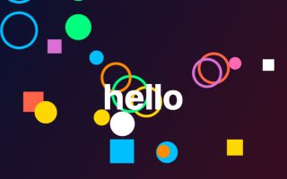

The whole picture shakes. Set strength when something hits, and let it fall away.

```py
shake(10)
```

| Setting | Starts at | Can be |
|---|---|---|
| `strength` | `10` | 0 to 200 |
| `speed` | `25` | 1 to 100 |
| `amount` | `1` | 0 to 1 |

### punch


A zoom in towards a point. Tie its strength to the beat.

```py
punch(0.15)
```

| Setting | Starts at | Can be |
|---|---|---|
| `strength` | `0.15` | -0.9 to 4 |
| `x` | the middle | a place in the scene |
| `y` | the middle | a place in the scene |
| `amount` | `1` | 0 to 1 |

## Blur and light

### zoom_blur


Rushing towards a point.

```py
zoom_blur(0.25)
```

| Setting | Starts at | Can be |
|---|---|---|
| `strength` | `0.25` | 0 to 1 |
| `x` | the middle | a place in the scene |
| `y` | the middle | a place in the scene |
| `amount` | `1` | 0 to 1 |

### spin_blur


Spinning round a point.

```py
spin_blur(8)
```

| Setting | Starts at | Can be |
|---|---|---|
| `angle` | `8` | -90 to 90 degrees |
| `x` | the middle | a place in the scene |
| `y` | the middle | a place in the scene |
| `amount` | `1` | 0 to 1 |

### motion_blur


Moving fast in one direction.

```py
motion_blur(24)
```

It looks at a dozen or more places for every pixel, so it costs a little more than most.

| Setting | Starts at | Can be |
|---|---|---|
| `size` | `24` | 0 to 300 |
| `angle` | `0` | -360 to 360 degrees |
| `amount` | `1` | 0 to 1 |

### tilt_shift


A band in focus and the rest blurred, which makes a scene look like a tiny model.

```py
tilt_shift(8)
```

It looks at a dozen or more places for every pixel, so it costs a little more than most.

| Setting | Starts at | Can be |
|---|---|---|
| `strength` | `8` | 0 to 60 |
| `size` | `70` | 5 to 1000 |
| `y` | the middle | a place in the scene |
| `amount` | `1` | 0 to 1 |

### light_rays

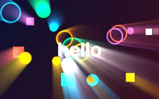

Rays of light streaming out from a point, through whatever is bright.

```py
light_rays(0.7)
```

Also called `god_rays`.

It looks at a dozen or more places for every pixel, so it costs a little more than most.

| Setting | Starts at | Can be |
|---|---|---|
| `strength` | `0.7` | 0 to 3 |
| `size` | `0.6` | 0 to 1 |
| `threshold` | `0.6` | 0 to 1 |
| `x` | the middle | a place in the scene |
| `y` | the middle | a place in the scene |
| `amount` | `1` | 0 to 1 |

### streaks

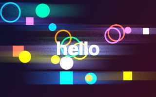

Long sideways flares from bright lights, as a film camera makes.

```py
streaks(0.6)
```

It looks at a dozen or more places for every pixel, so it costs a little more than most.

| Setting | Starts at | Can be |
|---|---|---|
| `strength` | `0.6` | 0 to 3 |
| `size` | `120` | 0 to 800 |
| `threshold` | `0.6` | 0 to 1 |
| `colour` | `"#88aaff"` | any colour |
| `amount` | `1` | 0 to 1 |

### soft_focus

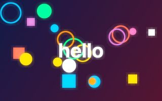

A soft, dreamy haze over the bright parts.

```py
soft_focus(0.6)
```

| Setting | Starts at | Can be |
|---|---|---|
| `strength` | `0.6` | 0 to 1 |
| `size` | `6` | 0 to 60 |
| `amount` | `1` | 0 to 1 |

### blur


Out of focus.

```py
blur(8)
```

It looks at a dozen or more places for every pixel, so it costs a little more than most.

| Setting | Starts at | Can be |
|---|---|---|
| `radius` | `8` | 0 to 200 |
| `amount` | `1` | 0 to 1 |

### glow


Bright things shine and spread light around them.

```py
glow(0.8)
```

Also called `bloom`.

It looks at a dozen or more places for every pixel, so it costs a little more than most.

| Setting | Starts at | Can be |
|---|---|---|
| `strength` | `0.8` | 0 to 4 |
| `threshold` | `0.5` | 0 to 1 |
| `radius` | `24` | 2 to 200 |
| `amount` | `1` | 0 to 1 |

## What was drawn stays

### smear


What was drawn is carried away on a slow current, like wet paint.

```py
smear(3)
```

It keeps its own last frame, so it wants a scene that moves.

| Setting | Starts at | Can be |
|---|---|---|
| `length` | `3` | 0 to 30 |
| `size` | `40` | 0 to 400 |
| `scale` | `150` | 20 to 1000 |
| `amount` | `1` | 0 to 1 |

### stutter


Only so many new pictures a second: the last one is held between them.

```py
stutter(8)
```

It keeps its own last frame, so it wants a scene that moves.

| Setting | Starts at | Can be |
|---|---|---|
| `speed` | `8` | 0.5 to 60 |
| `amount` | `1` | 0 to 1 |

### trails


What was drawn stays and fades. With zoom, spin and hue it becomes the classic screensaver tunnel.

```py
trails(0.5)
```

It looks at a dozen or more places for every pixel, so it costs a little more than most.

It keeps its own last frame, so it wants a scene that moves.

| Setting | Starts at | Can be |
|---|---|---|
| `length` | `0.5` | 0 to 20 seconds |
| `zoom` | `1` | 0.1 to 10 |
| `spin` | `0` | -720 to 720 degrees |
| `hue` | `0` | -720 to 720 degrees |
| `dx` | `0` | -2000 to 2000 |
| `dy` | `0` | -2000 to 2000 |
| `x` | the middle | a place in the scene |
| `y` | the middle | a place in the scene |
| `amount` | `1` | 0 to 1 |

## Colours

### rgb_split


Red and blue pulled apart, like a cheap lens or a bad signal.

```py
rgb_split(4)
```

| Setting | Starts at | Can be |
|---|---|---|
| `size` | `4` | 0 to 60 |
| `angle` | `0` | -360 to 360 degrees |
| `spread` | `False` | True or False |
| `amount` | `1` | 0 to 1 |

### hue


Every colour moved round the colour wheel. With speed, the colours keep turning.

```py
hue(90)
```

| Setting | Starts at | Can be |
|---|---|---|
| `shift` | `90` | -360 to 360 degrees |
| `speed` | `0` | -720 to 720 |
| `amount` | `1` | 0 to 1 |

### saturate


More colour, or less: at 0 the picture is grey.

```py
saturate(1.6)
```

| Setting | Starts at | Can be |
|---|---|---|
| `strength` | `1.6` | 0 to 4 |
| `amount` | `1` | 0 to 1 |

### brighten


Brighter, or darker below 1.

```py
brighten(1.3)
```

| Setting | Starts at | Can be |
|---|---|---|
| `strength` | `1.3` | 0 to 4 |
| `amount` | `1` | 0 to 1 |

### contrast


Lights lighter and darks darker.

```py
contrast(1.4)
```

| Setting | Starts at | Can be |
|---|---|---|
| `strength` | `1.4` | 0 to 4 |
| `amount` | `1` | 0 to 1 |

### invert


A negative: every colour swapped for its opposite.

```py
invert()
```

| Setting | Starts at | Can be |
|---|---|---|
| `amount` | `1` | 0 to 1 |

### posterize


Only a few shades of each colour, like a poster.

```py
posterize(4)
```

| Setting | Starts at | Can be |
|---|---|---|
| `levels` | `4` | 2 to 16, a whole number |
| `amount` | `1` | 0 to 1 |

### tint


Seen through coloured glass.

```py
tint("gold")
```

| Setting | Starts at | Can be |
|---|---|---|
| `colour` | `"gold"` | any colour |
| `amount` | `1` | 0 to 1 |

### duotone


Two colours only: one for the dark parts and one for the light.

```py
duotone("midnightblue", "gold")
```

| Setting | Starts at | Can be |
|---|---|---|
| `dark` | `"midnightblue"` | any colour |
| `light` | `"gold"` | any colour |
| `amount` | `1` | 0 to 1 |

### colour_cycle

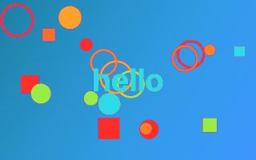

Brightness becomes a colour from a palette, and the colours move round.

```py
colour_cycle("rainbow")
```

Also called `color_cycle`.

| Setting | Starts at | Can be |
|---|---|---|
| `palette` | `"rainbow"` | a palette's name, or a list of colours |
| `speed` | `0.3` | -5 to 5 |
| `bands` | `1` | 0.1 to 8 |
| `amount` | `1` | 0 to 1 |

### gradient_map

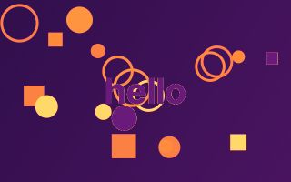

Brightness becomes a colour from a palette, dark to light.

```py
gradient_map("sunset")
```

| Setting | Starts at | Can be |
|---|---|---|
| `palette` | `"sunset"` | a palette's name, or a list of colours |
| `amount` | `1` | 0 to 1 |

### thermal

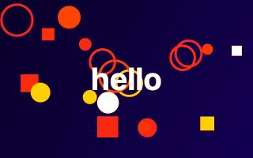

A heat camera: cold is dark blue, hot is yellow and white.

```py
thermal()
```

| Setting | Starts at | Can be |
|---|---|---|
| `palette` | `"thermal"` | a palette's name, or a list of colours |
| `amount` | `1` | 0 to 1 |

### night_vision

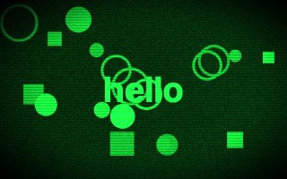

Green, grainy and bright in the dark, like a night-vision scope.

```py
night_vision(1.6)
```

| Setting | Starts at | Can be |
|---|---|---|
| `strength` | `1.6` | 0 to 6 |
| `amount` | `1` | 0 to 1 |

### sepia

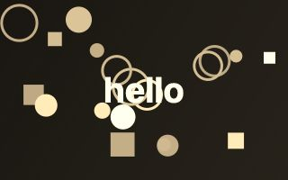

The warm brown of an old photograph.

```py
sepia(1)
```

| Setting | Starts at | Can be |
|---|---|---|
| `strength` | `1` | 0 to 1 |
| `amount` | `1` | 0 to 1 |

### threshold


Two colours and nothing between: dark or light.

```py
threshold(0.5)
```

| Setting | Starts at | Can be |
|---|---|---|
| `level` | `0.5` | 0 to 1 |
| `dark` | `"black"` | any colour |
| `light` | `"white"` | any colour |
| `amount` | `1` | 0 to 1 |

### solarize

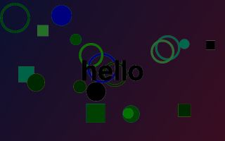

The bright parts turned to their opposite, as in an over-exposed photograph.

```py
solarize(0.5)
```

| Setting | Starts at | Can be |
|---|---|---|
| `level` | `0.5` | 0 to 1 |
| `amount` | `1` | 0 to 1 |

### colour_bleed


Colours smeared sideways, as on old videotape.

```py
colour_bleed(10)
```

Also called `color_bleed`.

| Setting | Starts at | Can be |
|---|---|---|
| `size` | `10` | 0 to 100 |
| `amount` | `1` | 0 to 1 |

### rainbow_edges


Every edge in the picture drawn in rainbow colours.

```py
rainbow_edges(2)
```

| Setting | Starts at | Can be |
|---|---|---|
| `strength` | `2` | 0 to 10 |
| `size` | `1.5` | 0.5 to 20 |
| `speed` | `0.1` | -5 to 5 |
| `amount` | `1` | 0 to 1 |

## Screens and old computers

### scanlines


Dark lines across the picture, as on an old screen.

```py
scanlines(0.5)
```

| Setting | Starts at | Can be |
|---|---|---|
| `strength` | `0.5` | 0 to 1 |
| `size` | `3` | 1 to 40 |
| `amount` | `1` | 0 to 1 |

### crt


An old television: curved glass, lines, and thin stripes of red, green and blue.

```py
crt(0.18)
```

| Setting | Starts at | Can be |
|---|---|---|
| `curve` | `0.18` | 0 to 1 |
| `lines` | `0.45` | 0 to 1 |
| `size` | `3` | 1 to 40 |
| `amount` | `1` | 0 to 1 |

### glitch


A broken signal: blocks that jump sideways, a line that tears, a band of snow.

```py
glitch(0.5)
```

| Setting | Starts at | Can be |
|---|---|---|
| `strength` | `0.5` | 0 to 1 |
| `speed` | `1` | 0 to 10 |
| `seed` | `1` | 0 to 9999, a whole number |
| `amount` | `1` | 0 to 1 |

### letters

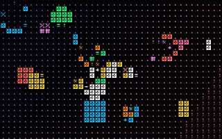

The picture made of marks, as an old terminal would show it.

```py
letters(10)
```

| Setting | Starts at | Can be |
|---|---|---|
| `size` | `10` | 4 to 100 |
| `colour` | `"white"` | any colour |
| `own` | `True` | True or False |
| `amount` | `1` | 0 to 1 |

### dither


A few colours made to pass for many with a pattern of dots, as old computers did.

```py
dither("gameboy")
```

| Setting | Starts at | Can be |
|---|---|---|
| `palette` | `"gameboy"` | a palette's name, or a list of colours |
| `size` | `2` | 1 to 40 |
| `strength` | `0.35` | 0 to 1 |
| `amount` | `1` | 0 to 1 |

### interlace


Every other line dark, swapping each frame, like old video.

```py
interlace(0.6)
```

| Setting | Starts at | Can be |
|---|---|---|
| `strength` | `0.6` | 0 to 1 |
| `size` | `2` | 1 to 20 |
| `amount` | `1` | 0 to 1 |

### led


A wall of round lamps.

```py
led(8)
```

| Setting | Starts at | Can be |
|---|---|---|
| `size` | `8` | 3 to 80 |
| `amount` | `1` | 0 to 1 |

## Drawn, printed and painted

### edges


Only the outlines, each in its own colour.

```py
edges(2)
```

| Setting | Starts at | Can be |
|---|---|---|
| `strength` | `2` | 0 to 10 |
| `size` | `1.5` | 0.5 to 20 |
| `fill` | `0` | 0 to 1 |
| `amount` | `1` | 0 to 1 |

### dots


Printed in dots, big where the picture is bright, as a comic or a newspaper is.

```py
dots(9)
```

Also called `halftone`.

| Setting | Starts at | Can be |
|---|---|---|
| `size` | `9` | 2 to 100 |
| `angle` | `25` | -360 to 360 degrees |
| `paper` | `"black"` | any colour |
| `amount` | `1` | 0 to 1 |

### emboss

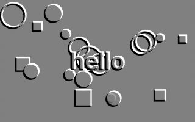

Pressed into grey metal: only the bumps and hollows show.

```py
emboss(2)
```

| Setting | Starts at | Can be |
|---|---|---|
| `strength` | `2` | 0 to 10 |
| `angle` | `135` | -360 to 360 degrees |
| `size` | `1.5` | 0.5 to 20 |
| `amount` | `1` | 0 to 1 |

### sharpen


Crisper edges.

```py
sharpen(1)
```

| Setting | Starts at | Can be |
|---|---|---|
| `strength` | `1` | 0 to 5 |
| `size` | `1` | 0.5 to 10 |
| `amount` | `1` | 0 to 1 |

### sketch


A pencil drawing on paper.

```py
sketch(3)
```

| Setting | Starts at | Can be |
|---|---|---|
| `strength` | `3` | 0 to 10 |
| `size` | `1.2` | 0.5 to 20 |
| `paper` | `"#f4efe2"` | any colour |
| `colour` | `"#2a2a33"` | any colour |
| `amount` | `1` | 0 to 1 |

### cartoon

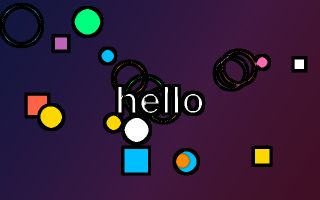

Flat colours and black outlines.

```py
cartoon(4)
```

| Setting | Starts at | Can be |
|---|---|---|
| `levels` | `4` | 2 to 12, a whole number |
| `strength` | `2.5` | 0 to 10 |
| `size` | `1.5` | 0.5 to 20 |
| `amount` | `1` | 0 to 1 |

### stained_glass

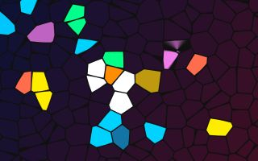

Pieces of coloured glass with dark lead between them.

```py
stained_glass(40)
```

| Setting | Starts at | Can be |
|---|---|---|
| `size` | `40` | 8 to 400 |
| `colour` | `"#101010"` | any colour |
| `amount` | `1` | 0 to 1 |

### crosshatch

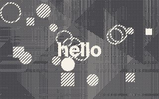

Shaded with crossing pen lines: more lines where it is darker.

```py
crosshatch(6)
```

| Setting | Starts at | Can be |
|---|---|---|
| `size` | `6` | 2 to 60 |
| `colour` | `"#1a1a22"` | any colour |
| `paper` | `"#f6f2e8"` | any colour |
| `amount` | `1` | 0 to 1 |

### oil

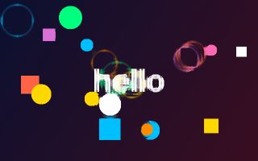

Smoothed into patches of colour, like oil paint. Heavy: it looks at 36 places for every pixel.

```py
oil(4)
```

**Heavy.** It looks at dozens of places for every pixel: use it alone, or with `effects_quality(0.5)`.

| Setting | Starts at | Can be |
|---|---|---|
| `size` | `4` | 1 to 30 |
| `amount` | `1` | 0 to 1 |

## In front of the picture

### grain


The fine speckle of film.

```py
grain(0.18)
```

| Setting | Starts at | Can be |
|---|---|---|
| `strength` | `0.18` | 0 to 1 |
| `size` | `1.5` | 0.5 to 20 |
| `seed` | `1` | 0 to 9999, a whole number |
| `amount` | `1` | 0 to 1 |

### vignette

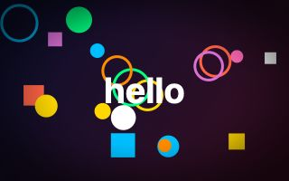

Dark corners, which draw the eye to the middle.

```py
vignette(0.6)
```

| Setting | Starts at | Can be |
|---|---|---|
| `strength` | `0.6` | 0 to 1 |
| `size` | `0.75` | 0 to 2 |
| `colour` | `"black"` | any colour |
| `amount` | `1` | 0 to 1 |

### dust

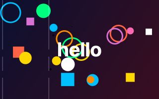

Specks and scratches, as on old film.

```py
dust(0.5)
```

| Setting | Starts at | Can be |
|---|---|---|
| `strength` | `0.5` | 0 to 1 |
| `seed` | `1` | 0 to 9999, a whole number |
| `amount` | `1` | 0 to 1 |

### light_leaks

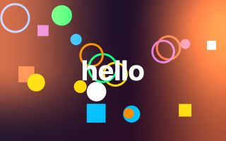

Warm light creeping in from the sides, as in an old camera.

```py
light_leaks(0.6)
```

| Setting | Starts at | Can be |
|---|---|---|
| `strength` | `0.6` | 0 to 2 |
| `speed` | `0.2` | -5 to 5 |
| `colour` | `"#ff7a2a"` | any colour |
| `amount` | `1` | 0 to 1 |

### rain


Rain falling in front of the picture.

```py
rain(0.6)
```

| Setting | Starts at | Can be |
|---|---|---|
| `strength` | `0.6` | 0 to 2 |
| `speed` | `1` | 0 to 5 |
| `angle` | `12` | -80 to 80 degrees |
| `amount` | `1` | 0 to 1 |

### snow


Snow falling in front of the picture.

```py
snow(0.8)
```

| Setting | Starts at | Can be |
|---|---|---|
| `strength` | `0.8` | 0 to 2 |
| `speed` | `1` | 0 to 5 |
| `size` | `3` | 0.5 to 20 |
| `amount` | `1` | 0 to 1 |

### bokeh

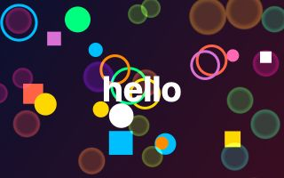

Soft discs of coloured light drifting by: lamps out of focus.

```py
bokeh(0.5)
```

| Setting | Starts at | Can be |
|---|---|---|
| `strength` | `0.5` | 0 to 2 |
| `size` | `30` | 4 to 200 |
| `speed` | `0.3` | -5 to 5 |
| `amount` | `1` | 0 to 1 |

### fog

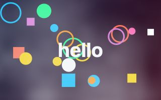

Drifting mist, thicker towards the bottom.

```py
fog(0.6)
```

| Setting | Starts at | Can be |
|---|---|---|
| `strength` | `0.6` | 0 to 1 |
| `speed` | `0.3` | -5 to 5 |
| `scale` | `220` | 20 to 2000 |
| `colour` | `"#dfe6ee"` | any colour |
| `amount` | `1` | 0 to 1 |

### lightning


A flash, now and then.

```py
lightning(1)
```

| Setting | Starts at | Can be |
|---|---|---|
| `strength` | `1` | 0 to 3 |
| `speed` | `1` | 0 to 10 |
| `seed` | `1` | 0 to 9999, a whole number |
| `amount` | `1` | 0 to 1 |

## Backdrops that need no drawing

A backdrop is a picture the graphics card makes by itself. It is behind whatever you draw, and shows wherever the canvas is clear: wipe the picture each frame with `background()` (no colour) rather than painting over it.

### plasma

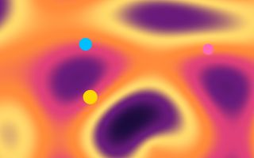

Slow rolling colour.

```py
plasma("sunset")
```

| Setting | Starts at | Can be |
|---|---|---|
| `palette` | `"sunset"` | a palette's name, or a list of colours |
| `speed` | `0.3` | -5 to 5 |
| `scale` | `1` | 0.1 to 10 |
| `amount` | `1` | 0 to 1 |

### starfield

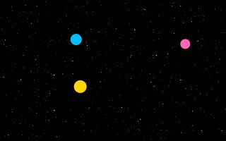

Flying through stars.

```py
starfield(0.5)
```

| Setting | Starts at | Can be |
|---|---|---|
| `speed` | `0.5` | -5 to 5 |
| `stars` | `1` | 0 to 4 |
| `colour` | `"white"` | any colour |
| `x` | the middle | a place in the scene |
| `y` | the middle | a place in the scene |
| `amount` | `1` | 0 to 1 |

### metaballs

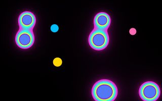

Blobs that melt into each other when they meet: a lava lamp.

```py
metaballs("neon")
```

| Setting | Starts at | Can be |
|---|---|---|
| `palette` | `"neon"` | a palette's name, or a list of colours |
| `speed` | `0.5` | -5 to 5 |
| `count` | `7` | 1 to 12, a whole number |
| `size` | `1` | 0.2 to 4 |
| `amount` | `1` | 0 to 1 |

### flow

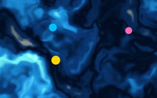

Colour that folds and curls like ink in water.

```py
flow("ocean")
```

| Setting | Starts at | Can be |
|---|---|---|
| `palette` | `"ocean"` | a palette's name, or a list of colours |
| `speed` | `0.2` | -5 to 5 |
| `scale` | `1` | 0.1 to 10 |
| `amount` | `1` | 0 to 1 |

### warp

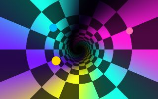

A chequered tunnel rushing past.

```py
warp("neon")
```

| Setting | Starts at | Can be |
|---|---|---|
| `palette` | `"neon"` | a palette's name, or a list of colours |
| `speed` | `1` | -10 to 10 |
| `x` | the middle | a place in the scene |
| `y` | the middle | a place in the scene |
| `amount` | `1` | 0 to 1 |

### voronoi


Soft coloured cells that slowly shift.

```py
voronoi("candy")
```

| Setting | Starts at | Can be |
|---|---|---|
| `palette` | `"candy"` | a palette's name, or a list of colours |
| `speed` | `0.3` | -5 to 5 |
| `scale` | `1` | 0.1 to 10 |
| `amount` | `1` | 0 to 1 |

### moire

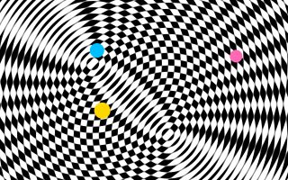

Two sets of rings crossing, making patterns neither has alone.

```py
moire("white")
```

| Setting | Starts at | Can be |
|---|---|---|
| `colour` | `"white"` | any colour |
| `speed` | `0.3` | -5 to 5 |
| `scale` | `1` | 0.1 to 10 |
| `amount` | `1` | 0 to 1 |

### interference


Waves from four moving points, crossing.

```py
interference("ocean")
```

| Setting | Starts at | Can be |
|---|---|---|
| `palette` | `"ocean"` | a palette's name, or a list of colours |
| `speed` | `0.5` | -5 to 5 |
| `scale` | `1` | 0.1 to 10 |
| `amount` | `1` | 0 to 1 |

### aurora

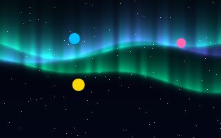

The northern lights over a night sky.

```py
aurora("aurora")
```

| Setting | Starts at | Can be |
|---|---|---|
| `palette` | `"aurora"` | a palette's name, or a list of colours |
| `speed` | `0.3` | -5 to 5 |
| `amount` | `1` | 0 to 1 |

### fire


Flames rising from the bottom of the picture.

```py
fire("fire")
```

| Setting | Starts at | Can be |
|---|---|---|
| `palette` | `"fire"` | a palette's name, or a list of colours |
| `speed` | `1` | -5 to 5 |
| `scale` | `1` | 0.1 to 10 |
| `amount` | `1` | 0 to 1 |

### clouds

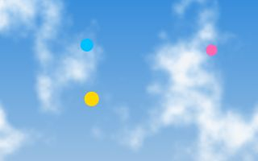

A sky with drifting clouds.

```py
clouds("#3a8fdc")
```

| Setting | Starts at | Can be |
|---|---|---|
| `colour` | `"#3a8fdc"` | any colour |
| `speed` | `0.1` | -5 to 5 |
| `scale` | `1` | 0.1 to 10 |
| `amount` | `1` | 0 to 1 |

### matrix_rain


Green marks falling in columns.

```py
matrix_rain("#3dff7a")
```

| Setting | Starts at | Can be |
|---|---|---|
| `colour` | `"#3dff7a"` | any colour |
| `speed` | `1` | 0 to 10 |
| `size` | `14` | 6 to 80 |
| `amount` | `1` | 0 to 1 |

### copper_bars

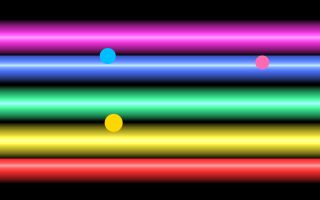

Shining bars sliding up and down: a demo-scene classic.

```py
copper_bars("rainbow")
```

| Setting | Starts at | Can be |
|---|---|---|
| `palette` | `"rainbow"` | a palette's name, or a list of colours |
| `count` | `5` | 1 to 8, a whole number |
| `speed` | `1` | -5 to 5 |
| `size` | `34` | 4 to 300 |
| `amount` | `1` | 0 to 1 |

### checker_floor


A chequered floor rushing towards you under a glowing horizon.

```py
checker_floor("#ff2a6d")
```

| Setting | Starts at | Can be |
|---|---|---|
| `colour` | `"#ff2a6d"` | any colour |
| `dark` | `"#101a3a"` | any colour |
| `speed` | `1` | -10 to 10 |
| `amount` | `1` | 0 to 1 |

### twister

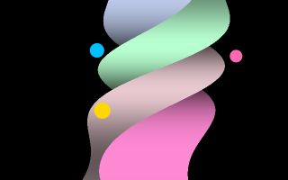

A twisting four-sided bar, another demo-scene classic.

```py
twister("candy")
```

| Setting | Starts at | Can be |
|---|---|---|
| `palette` | `"candy"` | a palette's name, or a list of colours |
| `speed` | `1` | -5 to 5 |
| `size` | `0.22` | 0.02 to 0.5 |
| `amount` | `1` | 0 to 1 |

## The music, drawn

These follow the scene's sound. With no sound they are still and dark.

### spectrum_bars


The music as bars: low notes at the left, high at the right.

```py
spectrum_bars("rainbow")
```

| Setting | Starts at | Can be |
|---|---|---|
| `palette` | `"rainbow"` | a palette's name, or a list of colours |
| `count` | `32` | 4 to 64, a whole number |
| `size` | `0.7` | 0.05 to 1 |
| `amount` | `1` | 0 to 1 |

### spectrum_ring

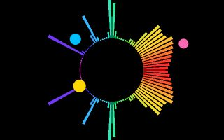

The music as bars round a ring.

```py
spectrum_ring("rainbow")
```

| Setting | Starts at | Can be |
|---|---|---|
| `palette` | `"rainbow"` | a palette's name, or a list of colours |
| `size` | `90` | 10 to 1000 |
| `x` | the middle | a place in the scene |
| `y` | the middle | a place in the scene |
| `amount` | `1` | 0 to 1 |

### waveform_ring

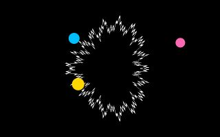

The sound's own wave, bent into a ring.

```py
waveform_ring("white")
```

| Setting | Starts at | Can be |
|---|---|---|
| `colour` | `"white"` | any colour |
| `size` | `110` | 10 to 1000 |
| `strength` | `3` | 0.5 to 40 |
| `x` | the middle | a place in the scene |
| `y` | the middle | a place in the scene |
| `amount` | `1` | 0 to 1 |

### beat_flash

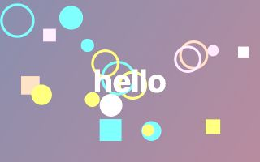

A flash of colour on each beat.

```py
beat_flash(0.5)
```

| Setting | Starts at | Can be |
|---|---|---|
| `strength` | `0.5` | 0 to 2 |
| `colour` | `"white"` | any colour |
| `amount` | `1` | 0 to 1 |

### bass_shake


The picture shakes with the bass.

```py
bass_shake(14)
```

| Setting | Starts at | Can be |
|---|---|---|
| `strength` | `14` | 0 to 200 |
| `speed` | `25` | 1 to 100 |
| `amount` | `1` | 0 to 1 |

## Looks

A look is several effects at once: `look("dream")`. It has `amount`, `off()`, `on()` and `remove()` for the lot.

### look: dream

<a id="look-dream"></a>


Soft, glowing and rich.

`look("dream")` is `glow(strength=1, threshold=0.35, radius=40)`, then `saturate(strength=1.3)`, then `vignette(strength=0.5)`.

### look: arcade

<a id="look-arcade"></a>


The curved glass of an old arcade machine.

`look("arcade")` is `glow(strength=0.7, threshold=0.4, radius=20)`, then `crt(curve=0.2, lines=0.5)`.

### look: vhs

<a id="look-vhs"></a>

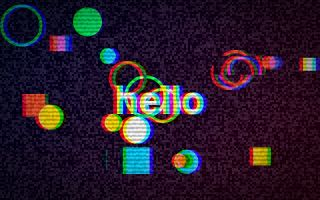

A worn videotape.

`look("vhs")` is `saturate(strength=1.35)`, then `rgb_split(size=3)`, then `glitch(strength=0.35)`, then `scanlines(strength=0.3, size=4)`, then `grain(strength=0.2, size=2)`, then `vignette(strength=0.45)`.

### look: neon

<a id="look-neon"></a>

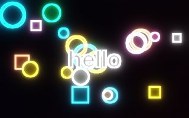

Glowing outlines in the dark.

`look("neon")` is `edges(strength=3, fill=0.15)`, then `glow(strength=1.4, threshold=0.2, radius=28)`.

### look: comic

<a id="look-comic"></a>

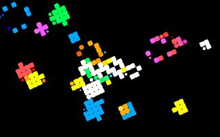

A few flat colours, printed in dots.

`look("comic")` is `posterize(levels=4)`, then `dots(size=7)`.

### look: underwater

<a id="look-underwater"></a>


Blue, wobbling and dim at the edges.

`look("underwater")` is `wobble(size=10, scale=160)`, then `tint(colour="#7fd4ff")`, then `glow(strength=0.5, threshold=0.5)`, then `vignette(strength=0.6, colour="#001830")`.

### look: oldfilm

<a id="look-oldfilm"></a>


Brown, grainy and dark at the corners.

`look("oldfilm")` is `duotone(dark="#1a1208", light="#f2e2c0")`, then `grain(strength=0.3, size=2)`, then `vignette(strength=0.75)`.

### look: disco

<a id="look-disco"></a>

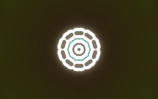

A kaleidoscope whose colours keep turning.

`look("disco")` is `kaleidoscope(segments=10)`, then `hue(shift=0, speed=60)`, then `glow(strength=0.8)`.

### look: gameboy

<a id="look-gameboy"></a>

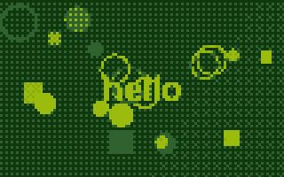

Four shades of green.

`look("gameboy")` is `dither(palette="gameboy", size=3)`.

### look: c64

<a id="look-c64"></a>


The colours of a 1980s home computer.

`look("c64")` is `dither(palette="c64", size=3)`, then `scanlines(strength=0.2, size=3)`.

### look: noir

<a id="look-noir"></a>


Black and white, high contrast, grainy.

`look("noir")` is `saturate(strength=0)`, then `contrast(strength=1.6)`, then `grain(strength=0.25, size=2)`, then `vignette(strength=0.8)`.

### look: comicbook

<a id="look-comicbook"></a>

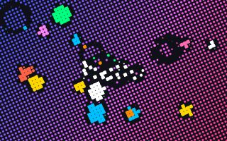

Black outlines over printed dots.

`look("comicbook")` is `cartoon(levels=4)`, then `dots(size=5, paper="#101018")`.

### look: storm

<a id="look-storm"></a>


Rain, lightning and fog.

`look("storm")` is `rain(strength=0.7)`, then `lightning()`, then `fog(strength=0.35, colour="#8a94a8")`, then `vignette(strength=0.6)`.

### look: winter

<a id="look-winter"></a>


Cold light and falling snow.

`look("winter")` is `tint(colour="#cfe4ff")`, then `snow()`, then `soft_focus(strength=0.4)`, then `vignette(strength=0.4, colour="#0a1830")`.

### look: cinema

<a id="look-cinema"></a>


A film camera: flares, a narrow focus, grain.

`look("cinema")` is `streaks(strength=0.5)`, then `tilt_shift(strength=5)`, then `grain(strength=0.1)`, then `vignette(strength=0.5)`.

### look: terminal

<a id="look-terminal"></a>

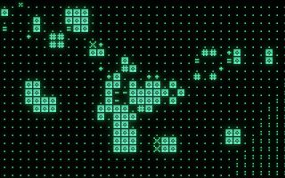

Green marks on a dark screen.

`look("terminal")` is `letters(size=9, own=False, colour="#3dff7a")`, then `glow(strength=0.6, threshold=0.2, radius=14)`, then `scanlines(strength=0.25)`.
