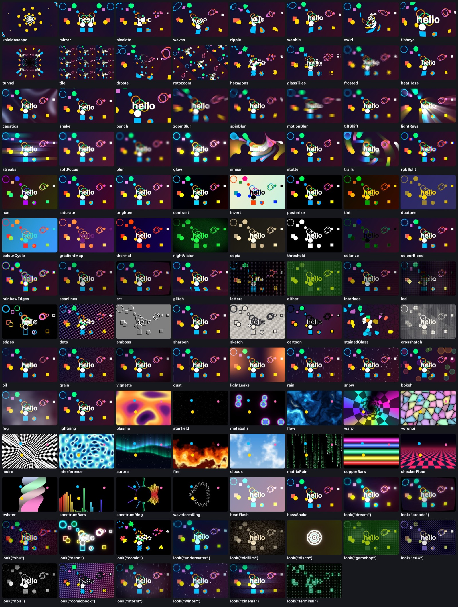

# Effects

A scene can have effects on it: a glow, trails, a kaleidoscope, an old television, rain. You draw some shapes and turn one on. The page's graphics card does the work, so they are fast.



```python
from pyvisualfx import *

glow(1)                 # bright things shine
trails(1.5)             # and leave a trail that takes a second and a half to fade

def draw():
    background("black")
    circle(mouse.x, mouse.y, 40, "gold")
```

That is a whole scene. There is nothing to call in `draw()`: an effect that is on is done to every frame, after your drawing.

**[Every effect](effects-reference.md)** is the list, with a picture of each and its settings.

## Turn one on

```python
import math
from pyvisualfx import *

kaleidoscope(8)         # eight segments

def draw():
    background("midnightblue")
    for i in range(12):
        circle(width / 2 + i * 30, height / 2 + 20 * math.sin(i), 14, "gold")
```

Every effect is a function, and calling it turns it on. The first value is the one you most often want to change, and it has a sensible value if you leave it out. `help(trails)` lists a function's settings.

A kaleidoscope shows one slice of your picture, the one that starts at the middle and points right, folded round and round. If the screen goes dark, nothing was drawn in that slice: fill the picture, or turn the slice with `angle`.

## Change its settings

```python
from pyvisualfx import *

pattern = kaleidoscope(8, zoom=1.5)

def update(dt):
    pattern.angle += 20 * dt        # turn it, twenty degrees a second
    pattern.x = mouse.x             # its middle follows the mouse
    pattern.y = mouse.y

def draw():
    background("midnightblue")
    for i in range(40):
        star((i * 97) % width, (i * 61) % height, 16, 5, "gold" if i % 2 else "tomato")
```

An effect's settings are plain attributes: read them, set them, add to them, every frame if you like. The first goes in plainly and the rest by name. Lengths are in the same points as the rest of your scene and angles are in degrees, so a scene looks the same on a phone and on a big screen.

Each effect has `off()`, `on()` and `remove()`, and `amount` from 0 to 1 for how much of it is mixed in. `clear_effects()` takes them all away. A mistake is said on the line that made it:

```
ValueError: mirror's side is one of "left", "right", "top", "bottom", "four", not 'sideways'
```

## Several at once

```python
import math
from pyvisualfx import *

kaleidoscope(6)
trails(0.7, zoom=1.5, spin=25, hue=90)
glow(0.7)
vignette()

t = 0

def update(dt):
    global t
    t += dt

def draw():
    background("black")
    star(width / 2 + 120, height / 2 + 40 * math.sin(t), 16, 5, "gold")
    circle(width / 2 + 60, height / 2 + 20, 10 + 6 * math.sin(t * 3), "tomato")
```

Effects are done **in the order you turn them on**. Here the picture is folded, then the folded picture leaves trails, then all of it glows. Swap two lines and you get a different picture.

**Trails** are how the classic screensaver tunnel is made: each frame is last frame's picture, a little bigger (`zoom`: 2 doubles its size every second), a little turned (`spin`, degrees a second) and a little changed in colour (`hue`), with this frame's drawing on top. Trails want a dark background: only what is brighter than the trail is seen over it.

`look("arcade")` is several effects at once, ready-made: `dream`, `arcade`, `vhs`, `neon`, `comic`, `noir`, `storm`, `gameboy` and more.

## A picture with no drawing at all

```python
from pyvisualfx import *

metaballs("lava")       # blobs that melt into each other
glow(0.6)

def draw():
    background()        # with no colour: wipe the picture clear
```

`plasma`, `flow`, `metaballs`, `starfield`, `fire`, `aurora`, `clouds`, `matrix_rain` and the rest of the **backdrops** are pictures the graphics card makes by itself. They are behind whatever you draw, and show wherever you have left the canvas clear. So do not paint a background colour over them: `background()` with no colour wipes the canvas clear each frame.

## Music

With [sound](sound.md) in the scene, the effects can move to it.

```python
from synths import *
from pyvisualfx import *

play_notes("C2 - C2 C2 - C2 G1 -", 0.25, repeat=True)

shine = glow(0.5)
react(shine, "strength", "bass", 0.4, 1.5)      # the glow follows the bass

def draw():
    background("black")
    circle(width / 2, height / 2, 30 + 60 * bass(), "tomato")
```

`react(effect, "setting", band, low, high)` ties a setting to the music: `"bass"`, `"mids"`, `"highs"`, `"loudness"`, or `"pulse"`, which jumps on each beat and falls away. It is done in the page, on the beat, with no trip through Python.

`bass()`, `mids()`, `highs()`, `loudness()` and `pulse()` are the same numbers for your own drawing, from 0 to 1. They are what the page last told Python, so they are a frame late: fine for the size of a circle, and `react` is there for anything that must be exact.

The effects listen to all of the scene's sound by themselves; `listen_to(lead)` listens to one synth instead. With no sound the numbers are 0 and nothing goes wrong. `spectrum_bars()`, `spectrum_ring()` and `waveform_ring()` draw the music itself.

## With dials

An effect is something a [dial](dials.md) can turn. The dial takes its range from the effect, and is drawn over the effects, so it is never blurred or folded.

```python
from pydials import *
from pyvisualfx import *

soft = blur(4)
dial("blur", soft, "radius")

def draw():
    background("midnightblue")
    star(width / 2, height / 2, 100, 5, "gold")
```

The dial turns the effect from Python, so the blur follows the dial a frame later.

## With scenes

In a file of several [scenes](scenes.md), an effect turned on at the top of the file is on for all of them. One turned on in a scene's `setup` is yours to take away when the scene ends:

```python
from pyvisualfx import *

class Title(Scene):
    def setup(self):
        self.shine = glow(1.2)
    def draw(self):
        background("black")
        text("PRESS A KEY", width / 2, height / 2, "gold", 40, "centre")
    def on_key_down(self, key):
        self.shine.remove()
        go("Game", transition="crossfade")

class Game(Scene):
    def draw(self):
        background("navy")
        circle(mouse.x, mouse.y, 30, "white")
```

A change of scene is seen **through** the effects: the old scene's picture and the new one are mixed by the transition, and the effects are done to the mix.

## A shader of your own

If you know the language graphics cards speak (GLSL), an effect is one function: the colour at one place of the picture.

```python
from pyvisualfx import *

wave = shader("""
  vec4 effect(vec2 uv) {
    uv.x += 0.02 * sin(uv.y * 40.0 + time * speed);
    return texture(picture, uv);
  }""", speed=3)

def draw():
    background("midnightblue")
    star(width / 2, height / 2, 100, 5, "gold")
```

`uv` runs from (0, 0) at the top left to (1, 1) at the bottom right. Settings given by name are numbers the program can use, and attributes of the effect (`wave.speed = 6`). It is also given `picture` (the scene so far), `previous` (what this effect made last frame), `resolution` and `size`, `time`, `dt` and `frame`, `amount`, the music (`bass`, `mids`, `highs`, `loudness`, `pulse`, and the pictures `spectrum` and `waveform`), and small helpers: `hash`, `noise`, `fbm`, `luma`, `turn`, `hueTurn`, `mirrored`. A mistake in it is said by the page, with its line.

## How it works, and video

Python never touches the page: it may be in a worker, or on another computer. Each function here sends ONE command that turns the effect on in the page, and setting an attribute is one command more. The effects are run once for each frame Python sends, straight after its drawing, and their clock is the `dt` your `update(dt)` is given. So however slow Python is, the picture and its effects stay together.

Every effect is worked out from the picture, its own last frame, its settings and that clock, never from the time of day; grain and glitches come from a seed. So a scene recorded one frame at a time gives exactly the frames it should, the same every time.

A scene that does not import `pyvisualfx` is not sent the effects at all, and a page built from it (`pyctures build`) does not carry them. The import must be in the scene's own file: that is the file the page reads to know what to bring.

On an iPad or iPhone the effects work on fewer pixels than the screen has (about a 1080p picture's worth) and the result is stretched to fit, because handing a full-size picture to the graphics card is slow there. `effects_quality(1)` is every pixel, `effects_quality(0.5)` half each way, and `effects_quality("auto")` is what they do by themselves.

**On a phone or a tablet the speed has not been measured.** What has been measured is Safari's engine on a Mac, at an iPad's pixels (2360 x 1640) and a phone's (1170 x 2532): 9 to 12 milliseconds a frame for a chain of effects at every pixel, and 5 to 6 with `effects_quality("auto")`, where a frame at 60 a second has 16. A real iPad or iPhone has a slower graphics card than that Mac, so expect less; if a scene is slow there, `effects_quality(0.5)` is the first thing to try, and fewer effects the second.
