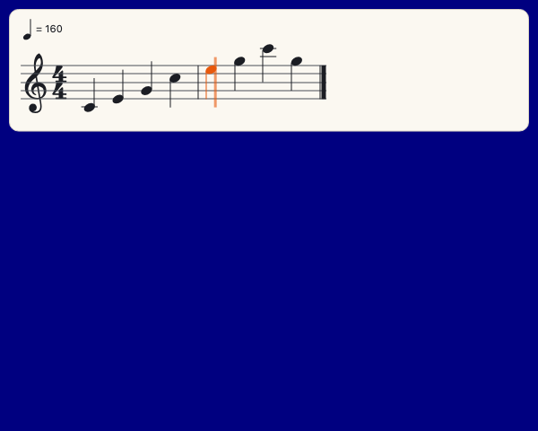

# Sheet music

A scene can write music out as notes on a staff, play it, and light each note as it sounds. You give it a tune in one line: there is nothing to draw.

```python
from pyctures import *
from pynotation import *

page = show_notes("E4 D4 C4 D4 E4 E4 E4:2", "quarter", title="Mary had a little lamb")

def on_mouse_down(x, y):
    page.play()

def draw():
    background("midnightblue")
    text("Click here to play", width / 2, height - 30, "white", 18, "centre")
```



The notes are written the way [`play_notes`](sound.md) takes them: a note is a letter and a number (`"C4"` is middle C, `"F#3"`, `"Bb5"`), `-` is a rest, `:2` makes a note last two steps, and `"quarter"` says how long a step is. The key, the clef and the bars are worked out for you. Change the notes in the line and both the music you hear and the music you see change.

`page.play()` plays it and follows it: the notes that are sounding turn orange, a line moves through the bar, and the page turns when the music reaches the next line. Tap a note to hear it. Tap a bar to play from there.

`from pynotation import *` brings the sound with it, so nothing else need be imported to hear the page. The first click, tap or key press on a page turns its sound on, as browsers require. A tune that is asked for before that waits, and begins when the sound is on: the line never moves through notes nobody can hear.

## What you can show

| You give | It is |
|---|---|
| `show_notes("C4 E4 G4 - C5:2", "quarter")` | a tune as text: notes, `-` for a rest, `:2` for two steps, `:q` `:h` `:e` `:s` `:w` for a length by name, `C4+E4+G4` or `Cm7` for a chord. The second thing is how long a step is (`"eighth"` if you leave it out) |
| `show_notes(["C4", None, ["C4", "E4"]], "quarter")` | the same as a list: `None` is a rest, a list inside is a chord |
| `show_notes(sheet)` | a sheet you write a note at a time |
| `show_notes("tune.json", channels=[0, 1])` | a tracker song beside the scene (or the song as a dictionary), a staff for each channel you choose |
| `show_notes([{"note": "C4", "start": 0, "length": 1}])` | plain data, in beats: anything can make this |

**A sheet** is for writing music as code, with loops and all:

```python
from pyctures import *
from pynotation import *

sheet = make_sheet(key="G", time="3/4", tempo=132, title="Waltz")
sheet.add("D4", "quarter")
sheet.add(["B4", "D5"], "half")          # a chord
sheet.rest("quarter")
for name in ["G4", "A4", "B4"]:
    sheet.add(name, "eighth")
show_notes(sheet)

def draw():
    background("#102030")
    text("A waltz has three beats in a bar", width / 2, height - 30, "white", 18, "centre")
```

A length is `"whole"`, `"half"`, `"quarter"`, `"eighth"`, `"sixteenth"` or `"thirtysecond"`, with a dot for half as long again (`"quarter."`), or a number of beats. A sheet that is added to later is drawn again by itself.

## Something on every note

`page.on_note` is called as each note begins, so the scene can do something in time with the music.

```python
import random

from pyctures import *
from pynotation import *

page = show_notes("C4 C4 G4 G4 A4 A4 G4:2 F4 F4 E4 E4 D4 D4 C4:2", "quarter", tempo=100)
stars = []

def on_note(note):
    stars.append([random.uniform(40, width - 40), height - 30, note.note - 50])

page.on_note = on_note

def on_mouse_down(x, y):
    if page.playing:
        page.stop()
    else:
        page.play()

def update(dt):
    for s in stars:
        s[1] -= 90 * dt

def draw():
    background("midnightblue")
    for x, y, size in stars:
        circle(x, y, size, "gold")
    text("Click to play, and again to stop", width / 2, height - 30, "white", 18, "centre")
```

A note has `note.name` (`"C4"`), `note.note` (its number: 60 is middle C), `note.notes` (a chord's), `note.start` and `note.length` in beats, and `note.staff`. `page.on_bar = fn` is called with the number of each bar as it begins. Python hears of a note a frame after the page lights it.

## Following a song

A tracker song (see [Sound and music](sound.md)) is written out from its own file, and the page follows it as it plays.

```py
from pyctures import *
from synths import *
from pynotation import *

song = play_song("tune.json")
page = show_notes("tune.json", channels=[0, 1], follow=song)

def draw():
    background("#0b1020")
    words = "bar %d" % page.bar if song.position["state"] == "playing" else "Tap to start the song"
    text(words, width / 2, height - 24, "white", 18, "centre")
```

Tap a bar and the song jumps there. A song's rows become beats (four rows to a beat at the usual speed), a note lasts until the next on its channel, a chord is written as a chord and an arpeggio as its chord with a wavy line beside it, and drums get a staff of their own. Notes that slide or bend are written as the notes they start from: the slide itself is not shown. `channels` chooses which channels and in what order, `grand=True` puts the tuned ones together on a piano's two staves, and `drums=["kick", "snare"]` says which instruments are drums when their names do not.

## Playing along

The learner plays, and the page says how it went.

```python
from pyctures import *
from synths import *
from pydials import *
from pynotation import *

lead = make_synth("keys")
page = show_notes("E4 D4 C4 D4 E4 E4 E4:2", "quarter")
page.play_along("wait", synth=lead)
keyboard(page, octave=4, octaves=1)        # the keys play the page

def draw():
    background("#12261e")
    text("%d right, %d wrong" % (page.result.right, page.result.wrong), width / 2, height / 2, "white", 20, "centre")
```

The line waits at each note until it is played, and the key to press is lit. A right note turns green; a wrong one shows in red for a moment where it was played. `"time"` in place of `"wait"` keeps going at the tempo, after a bar counted in, and a note that is never played turns red. The keyboard plays the page in the page itself, so a key is marked the moment it is touched. Notes can come from anywhere through `page.note_on(note)` and `page.note_off(note)`: a [MIDI keyboard](sound.md)'s `on_midi_note`, for one.

`page.result` has `right`, `wrong`, `missed`, `total`, `percent`, `timing` and `done` as it goes, and `page.on_done = fn` is called with it at the end.

## Options

After the music and the step: `show_notes("C4 D4", "quarter", key="G", tempo=90)`.

| Option | |
|---|---|
| `key` | `"C"`, `"G"`, `"Bb"`, `"Am"`, or sharps as a number (`2`) and flats as a negative one (`-3`). Left out: the key with the fewest sharps, flats and naturals to write |
| `time` | `"4/4"` unless you say: `"3/4"`, `"6/8"`, `"2/2"` |
| `clef` | `"treble"`, `"bass"`, `"grand"` (both, joined by a brace) or `"percussion"`. Left out: whichever the notes sit best in |
| `tempo` | beats a minute, for the mark over the first line and for `page.play()` |
| `title` | written over the music |
| `at` | `"top"` (where it goes unless you say), `"bottom"`, `"middle"`, `"fill"` (the whole picture); or `x`, `y`, `width` and `height` |
| `zoom` | 1 unless you say: 1.5 is half as big again |
| `paper` | `"light"` (cream paper, dark ink), `"dark"`, or `"clear"` (no paper: white ink straight on your scene) |
| `colours` | any of `paper`, `ink`, `line`, `now`, `right`, `wrong`, `cursor`, as a dictionary: `now` is the colour of a note that is sounding |
| `scroll` | `"down"`: lines of music one under another, and the page turns. `"across"`: one long line that slides past |
| `voice` | the ready-made synth `page.play()` plays on (`"keys"` unless you say: `"bell"`, `"lead"`…); `synth=lead` gives it a synth of yours |
| `follow` | a song to follow from the start |
| `lines`, `bar_numbers`, `line` | `False` hides the staff lines, the bar numbers, the moving line |
| `hear`, `seek` | `False`: a tapped note is not played; a tapped bar does not move the music |

## The page

| | |
|---|---|
| `page.play()` | play it and follow it. `page.play(start=8)` begins eight beats in; `tempo=90` |
| `page.stop()`, `page.playing` | stop it; is it playing? |
| `page.follow(song)` | follow a song from `play_song`, or a function that gives how many beats have gone by |
| `page.beat`, `page.bar`, `page.sounding` | where the music has got to, and the notes sounding, as the page last said |
| `page.on_note`, `page.on_bar`, `page.on_tap`, `page.on_done` | yours to set: a note began, a bar began, a note or a bar was tapped, the music ended |
| `page.play_along("wait")`, `page.note_on(note)`, `page.note_off(note)`, `page.result` | playing along |
| `page.seek(5)`, `page.show(music)` | go to bar 5; show other music in its place |
| `page.zoom = 1.5`, `page.place("bottom")` | its size and place |
| `page.remove()` | take it away |

## Good to know

- **The sound keeps the time.** `page.play()` plays the notes at a moment on the sound's clock and tells the page that moment; the page then lights the notes by itself, every frame, with no more said. A song is followed in the page from the place its own sound says the song is at. So the note that is lit is the note you hear, however long a frame of Python takes.
- **The music is drawn over your scene and under its dials.** It is in the page, on a canvas of its own: nothing in `draw()` is needed, and a `background()` does not wipe it.
- **A staff has one rhythm.** Notes that begin together are a chord, and a note ends where the next begins. Two tunes at once want two pages, or a song with a channel each.
- **Lengths are halves of halves.** Triplets are written to the nearest thirty-second note.
- **It is loaded only for a scene that imports it**, with `pyctures run`, in a built folder and in a single `.html` file. A scene that shows no music loads exactly what it always did.

Sheet music is [pynotation](https://github.com/johnwylie70/pynotation), whose half in the page is [notation.js](https://github.com/johnwylie70/notation.js). Its music symbols are outlines from the Leland font (SIL Open Font Licence).
